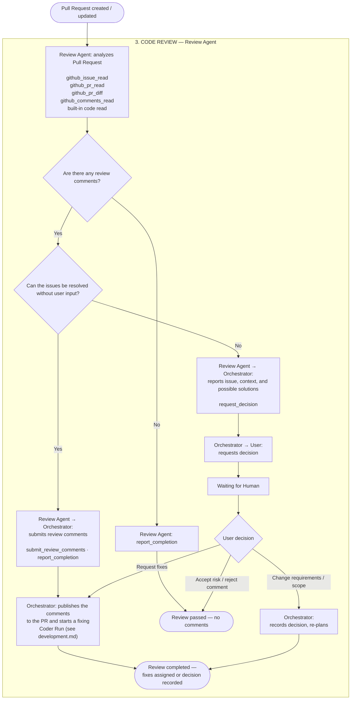

> Every Review Agent Run ends with `report_completion`. The review outcome (comments,
> approval, request changes) is published to the PR by the Orchestrator — the Review Agent
> never writes to GitHub. Round caps and no-progress handling are Orchestrator policy —
> not part of this flow.
