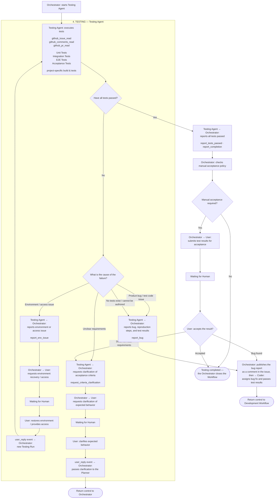

> Every Testing Agent Run ends with `report_completion`. Bug reports and testing outcomes
> are published to the issue by the Orchestrator — the Testing Agent never writes to GitHub.
> Missing tests are authored by the Coder (a fixing round) — the Testing Agent never
> writes product or test code. The manual-acceptance check (O2–O3) is the Orchestrator's
> policy decision.
