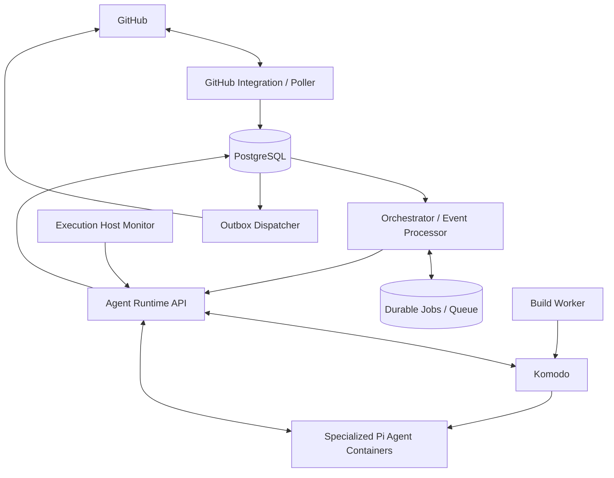
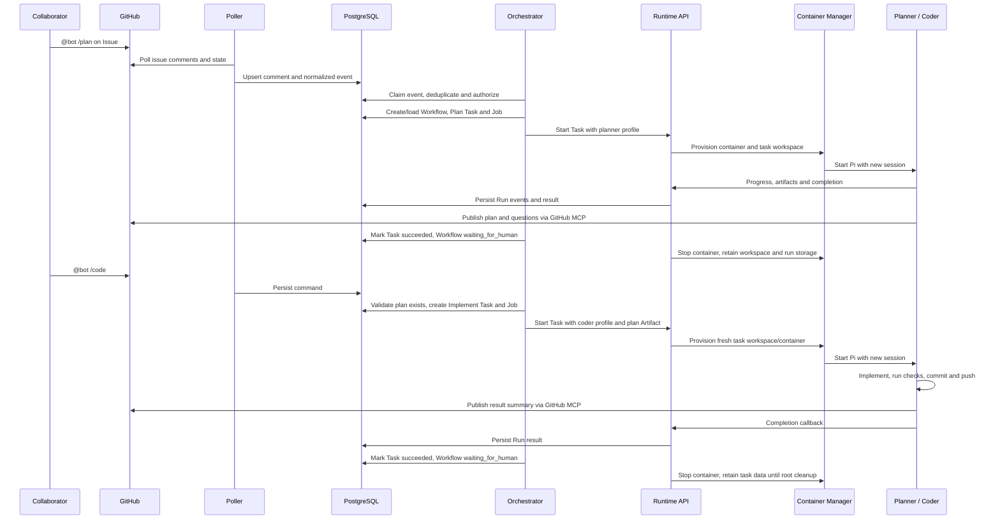

# Architecture and Flows

## 1. Goal and constraints

Build a GitHub-native multi-agent system. Users control agents through GitHub Issues, Pull Requests, and comments rather than by interacting with Pi in a terminal.

The system supports multiple specialized Pi agents. Each profile may have its own Docker image, skills, MCP servers, tools, prompts, environment, and resource configuration.

The current repository is a proof of concept. It demonstrates technical feasibility (GitHub polling, Pi sessions, GitHub MCP interaction, container spawning/Komodo), but its code, API, folder structure, runtime implementation, language, framework, and persistence approach are not constraints. They may be redesigned or fully replaced.

## 2. Logical architecture

### GitHub Integration / Poller

- Polls configured repositories over the GitHub REST API; default interval 60 seconds per repository (configurable per deployment).
- Synchronizes Issues, PRs, issue comments, PR conversation comments, inline review comments, reviews, review request additions/removals, comment edits/deletions, PR details (Head SHA, state, requested reviewers), and timeline events (`cross-referenced` and `closed` — the Issue↔PR link sources per decision 51; `connected`/`disconnected` synced as raw timeline records without V1 link semantics, relations reserved per decision 79). Full commit history is not synchronized in V1: PR head/base SHAs are stored, commit metadata is read from Git while preparing a workspace, and `pulls/{number}/commits` may be consulted ad hoc (decisions 64, 77).
- Comment edits update the stored body; deleted comments are tombstoned, not removed (see 02).
- Persists normalized records/events and per-stream sync cursors in PostgreSQL.
- Uses stable external IDs or deterministic fingerprints to deduplicate data.
- Advances a cursor only after the fetched page/batch is durably saved.
- Polling defaults: page size 100 (paging via `Link` headers), 5-minute overlap window for timestamp queries, per-repository/per-stream cursors; review requests (bot as reviewer) pending an initial review are rechecked each cycle; deleted comments are discovered via a periodic full sweep of known IDs (daily). Conditional requests use `ETag`/`If-None-Match` — a `304 Not Modified` does not consume the primary rate limit (5 000 req/h baseline); `403`/`429` responses honor `Retry-After`/`X-RateLimit-Reset`; secondary rate limits use bounded exponential backoff. Authentication: a fine-grained read-only PAT for syncing (write-capable PATs are used by agents, see decision 50 in 05).
- No public IP or inbound GitHub webhook is required for V1.

### Orchestrator

- Consumes persisted events and commands.
- Parses commands and checks target type, permissions, and Workflow state.
- Creates Workflows, Tasks, Runs, and durable queue jobs.
- Selects a versioned Agent Profile.
- The Context Assembler part of the Orchestrator builds each Run's input (instructions, WorkItem data, comments, prior artifacts) within the size limits and freezes it as an immutable `RunContextSnapshot` before the Run starts (02 §14a, decision 63).
- Enforces one active execution within a single workflow.
- Owns business-state transitions and decides what happens after completion, failure, timeout, cancellation, a human response, or root closure. A final Task failure (retries exhausted) returns the Workflow to `waiting_for_human`; Workflow `failed` is reserved for unrecoverable integrity/state-corruption failures.
- Publishes orchestration-owned system notifications (final Task failures, command rejections, cancellation confirmations) through the durable Outbox. Agent GitHub operations themselves are performed by the agents via GitHub MCP under profile permissions.

### Agent Runtime API

- Provisions the physical resources for each Run — Pi session files (one new session per attempt), the task workspace directory, and container/mounts, including the per-Run log directory — from Orchestrator-owned identifiers; AgentSession/Workspace DB records are owned by the Orchestrator.
- Creates/starts/stops container deployments via Komodo.
- Sends task instructions and inputs to Pi.
- Callbacks are emitted by the Runtime Bridge — a supervisor process inside the agent container that launches Pi in `--mode rpc` (with `--session-dir`//`--session-id` per Run), reads Pi's RPC stdout JSONL event stream (the session `.jsonl` file is history, not a realtime source), and posts events, a periodic heartbeat (default 30 seconds), completion, and failure callbacks to this API. It also captures Pi `stdout`/`stderr` and its own diagnostics into the per-Run log directory created and mounted by the Runtime API. Full Bridge contract: 04 §4, decisions 58–61.
- Receives progress, heartbeat, artifact, completion, and failure callbacks through routes on this same API; a separate webhook receiver service is not required.
- Reconciles desired state in PostgreSQL with actual Komodo/container state.
- Does not decide business workflow transitions.

### Execution Host Monitor

A small process on the single execution host. It observes what the control plane cannot: session-file activity, process trees, container state, and managed-storage usage via the local Docker API, and posts telemetry to the Runtime API over its own credential (decisions 62, 77). It does not run agents and does not make business decisions.

### Build Worker

Executes Agent Profile image builds locally on the execution host when a profile version is created (tag `agent-<profile>:v<n>`, local image store, no registry); a successful build sets the version `ready` (decisions 55–56).

### Outbox Dispatcher

A worker that delivers orchestration-owned system notifications to GitHub and owns Outbox retries, duplicate control, and dead-letter handling (02 §20, decision 67). It authenticates with repository-scoped write PATs.

### Configuration plane

V1 has no Admin API, CLI, or web UI: desired configuration is YAML in the system repository — `config/system.yaml` (global settings, `github.bot_login`, command grammar, operational knobs), `config/repositories.yaml` (registered repositories with per-repo allowlists, permitted commands, permitted WorkItem types, authorization policy), `config/routing.yaml` (routing rules: global defaults plus per-repo overrides), and `config/agents/<profile>/` (profile definitions). The Config Loader — a startup component of the Orchestrator — validates the configuration, creates/updates the corresponding DB records and sync cursors, and checks the bot identity against `GET /user`. Configuration is synchronized only at application startup/deployment; hot reload is out of scope (decisions 55–56). YAML is the source of desired configuration; PostgreSQL remains the source of runtime state.

### Komodo

Komodo - the container management layer. The Runtime API abstracts Komodo from the Orchestrator. Komodo + Komodo Api - single docker-compose

## 3. Agent profiles

Initial deployment ships a single profile: Planner.

Planned profiles (added later via configuration):

| Profile | Purpose | Default behavior |
|---|---|---|
| `planner` | Analyze requirements and repository; identify gaps; prepare implementation plan | Read/analyze, no code changes |
| `coder` | Implement approved work (enabled in a later phase) | Write code, run checks, commit and push branch |
| `reviewer` | Review a PR at a fixed Head SHA (enabled in a later phase) | Read-only review; submit findings |
| `test-designer` | Design test scenarios/cases (enabled in a later phase) | Produce test artifacts; do not implement tests by default |

No `debugger` profile exists (the `/debug` command was removed). Commands that select a missing, not-ready, or disabled profile are rejected before a Task is created (`agent_profile_not_configured`).

Profile configuration is versioned and can include image, Pi runtime config, system prompt, skills, MCP servers, tool permissions, environment references, capabilities, retry defaults, execution-limit defaults, and resource limits. A version carries an unattended permission allow-list: approved tools/MCP operations run automatically, everything else is denied — no interactive dialogs in agent runs.

Profile version images are built once when the version is created (local Docker build on the single execution host, tag `agent-<profile>:v<version>`, no external registry in V1) and only versions in the `ready` state are selectable. Changing the Dockerfile, dependencies, or configuration requires a new version. A Task pins one profile version so configuration changes do not alter an existing task.

Versions are created only through the configuration plane (`config/agents/<profile>/` → Config Loader → Build Worker, decisions 55–56). The image is the sole source of Pi runtime configuration in V1: the Pi version is pinned at build time and the profile's Pi configuration (settings, MCP, extensions, skills, prompts, system instructions) is baked read-only at `/opt/pi-agent/profile` and selected via `PI_CODING_AGENT_DIR`. LLM model/provider selection is deferred to V2 (decision 56).

Adding a profile should normally be configuration work, not a change to orchestration logic. Repository convention: keep each agent in its own directory (for example `config/agents/planner/`, `config/agents/coder/`, `config/agents/reviewer/`, `config/agents/test-designer/`), with its own Dockerfile/build context, Pi config, prompts, skills, and MCP configuration. The exact file layout can evolve, but profiles must not be entangled in one shared agent directory.

## 4. Data ownership

- GitHub is canonical for Issues, PRs, comments, reviews, branches, and commits.
- PostgreSQL is the source of truth for synchronized GitHub records, commands, workflows, tasks, runs, profile versions, state transitions, jobs, and artifact metadata.
- Pi session files live on persistent Docker-host storage in V1. Every Run attempt uses a new Pi session; a retry creates a new session.
- Artifacts are stored inline in PostgreSQL and passed to the next Task through its input; there is no shared artifact volume in V1.
- Agent containers have no host shell access (no host-bridge capability).
- Each Task has its own persistent workspace directory on the execution host (accompanied by per-Run session and log directories). The container can be stopped and restarted while the task data remains.
- Reviewer workspace is fresh and isolated from coder workspace.
- Agent profiles may expose selected GitHub MCP tools and other MCP servers. Agents are responsible for performing GitHub operations explicitly permitted by their profiles. The Agent Runtime records execution events and results, which are persisted by the Orchestrator. The Orchestrator remains responsible for workflow state, task scheduling, container lifecycle, command handling, and system-level notifications.
- Komodo owns actual deployment/container state; PostgreSQL stores desired and last observed state.
- AgentSession and Workspace DB records are owned (created/updated) by the Orchestrator; the Agent Runtime API owns physical provisioning (session files, workspace directory, per-Run log directory, container and mounts) and writes runtime metadata back.

## 5. WorkItem, Workflow, Task, Session, Run, Container

These are separate concepts:

- **WorkItem**: GitHub Issue or PR.
- **Workflow**: long-lived orchestration lifecycle for one root WorkItem.
- **Task**: one unit of work such as plan, implementation, review, or test design.
- **AgentSession**: a new Pi session for each Task.
- **Run**: one attempt to execute a Task; retry creates another Run.
- **Workspace**: persistent task-specific repository working copy/storage.
- **ContainerInstance**: replaceable container deployment used to execute a Run.

One Issue and a PR created from it are separate WorkItems and have separate Workflows. Store their relationship explicitly (via `WorkItemLink` with `closes` or `related_to`, decision 79). Closing the Issue must not silently close an independently open PR Workflow unless a future explicit policy says so.

## 6. Issue command flow: plan → human approval → code

Canonical comment syntax is `@<bot-account> /<command>`. The bot mention and command must be in the same comment for V1.

### Issue command rules

- Issue assignment to the bot is not required and is not used as a V1 trigger or execution switch; assigning/unassigning the bot does not start or interrupt a Task.
- An Issue command requires bot mention + recognized slash command.
- Caller must have GitHub Write permission and pass an optional configured allowlist restriction.
- Any ordinary Issue comment is synchronized but does not start an agent without a recognized command.
- `/plan` creates a `planner` Task and returns plan, gaps, and questions.
- `/code` creates a `coder` Task only after a successful plan Artifact (the latest successful planning Task); sending `/code` itself is the approval of that plan. There is no implement-without-plan mode in V1 (decision 80). Enabled once the coder phase ships.
- `/test-cases` creates a `test-designer` Task and produces test case artifacts; it does not imply implementation or execution of tests.
- `/status`, `/stop`, `/help`, and `/retry` are control/recovery commands and do not create new agent Tasks.
- Every Run attempt has a distinct Pi session. Tasks never share Pi conversation history.
- At most one unfinished Task may exist per Workflow: a further command for that Workflow is rejected at admission; commands for other Workflows are queued while execution capacity is busy.
- Workflow is returned to `waiting_for_human` after each completed, cancelled, or finally failed Task; it becomes `failed` only for an unrecoverable integrity/state-corruption failure and `closed` when the root WorkItem closes. Final failures are announced by the Orchestrator via the Outbox.

See [Command Reference](06-command-reference.md) for complete preconditions and effects of every command.

## 7. Pull Request flow

### Initial review

- The first review is triggered when GitHub reports that the bot account has been requested as a reviewer on a PR. A request recorded on a draft PR does not start the review; the automatic initial review starts when the PR becomes ready for review, under the conditions in 06 §11 (decision 74).
- Poller persists the `review_requested` event and current PR snapshot.
- Orchestrator creates one initial review Task for that request/PR state; exactly one automatic initial review Task exists per PR/Workflow lifetime, and removing the review request before execution starts cancels a not-yet-started Task.
- Reviewer gets a fresh workspace at the PR Head SHA, separate from any coder workspace, and read-only where possible.
- Reviewer inspects the diff and context, stores a review Artifact, and submits a review plus inline comments through Github MCP.

### Subsequent review

- `pull_request_synchronize` (new commit) updates PR data only; it does not trigger another review automatically.
- A subsequent review is started only when a collaborator explicitly comments `@<bot-account> /review`.
- Each explicit command is a new requested review, even if the Head SHA has not changed. Duplicate delivery of the same comment must not duplicate execution.
- Each review Task pins the PR Head SHA at Task creation (`target_head_sha`). If the Head SHA changed before a queued Task starts, the Task is cancelled (`review_head_changed_before_execution`) and a system notification asks for an explicit `/review` again. Results stay traceable to the exact revision.

## 8. Comment handling

Persist all relevant comments, including Issue comments, PR conversation comments, and inline review comments. The context supplied to a Task should include relevant prior discussion and, for PR review, the existing review threads/comments. In V1, a comment starts an agent only if it contains the bot mention and a recognized command. Ordinary replies and mentions without recognized commands remain context, not implicit instructions — this is decided for V1. A conversational mode (an explicit `/respond`//`/ask`, or mention-only dispatch) is a possible future extension.

## 9. Sequential scheduling

V1 enforces two limits: each Workflow holds at most one unfinished Task (a further command for that Workflow is rejected at admission), and the Orchestrator configuration bounds the total number of concurrently running Runs with `max_concurrent_runs` (default 10). When the cap is reached, work for other Workflows waits in the durable FIFO queue.

Use transactional claiming/leases in PostgreSQL so that multiple Orchestrator workers cannot claim the same job.

## 10. Workspace, container, and session lifecycle

- Every Task has its own Pi session and workspace.
- A container is an execution resource, not the durable identity of the Task.
- When a Task finishes, stop its container. Retain the task workspace directory and the Runs' `pi-session/` and `logs/` directories on persistent host storage (under `/var/lib/pi-agent/workflows/{workflow_id}/`) so the task can be inspected or resumed according to retry policy.
- Every Run attempt uses a new Pi session (a retry creates a new Run and a new session for the same Task). Sessions are isolated with pi's own CLI mechanics — Pi runs with `--session-dir` pointed at the mounted per-Run host directory and `--session-id <runId>`; profile Pi configuration is baked into the version image at `/opt/pi-agent/profile` and selected via `PI_CODING_AGENT_DIR` (decision 57). Workspace reuse follows task-type policy: a retry may reuse the Task workspace if it remains valid, a coder Task continues its existing agent branch, and a reviewer always gets a fresh workspace. V1 never rebases automatically onto a moved default branch — a manual rebase before PR creation may be required (accepted limitation, decision 72).
- Run `stdout`/`stderr` and Bridge diagnostics are written to a per-Run log directory on persistent host storage, created and mounted by the Runtime API; the files are deleted at root cleanup.
- A Reviewer always receives a fresh workspace at the review SHA.
- The coder must save changes, commit, push a branch, and report the branch/result in the Issue before marking implementation successful.
- Automatic PR creation is not done in V1; the preferred future path is an explicit `/create-pr` command (an explicit user action), not implicit profile configuration.

## 11. Root WorkItem closure and cleanup

When a root Issue or PR closes:
1. Prevent new commands/tasks for that root item (except read-only status/help if desired).
2. Cancel active/queued Tasks and stop active Runs.
3. Stop and remove associated containers/Komodo deployments.
4. Delete the Workflow storage tree — task workspace directories and per-Run `pi-session/` and `logs/` under `/var/lib/pi-agent/workflows/{workflow_id}/`.
5. Mark deletion/cleanup timestamps and storage status in PostgreSQL.
6. Preserve DB records, comments, events, task/run history, and artifact metadata.

Issue and its related PR are separate roots. Closing one does not automatically clean up the other unless an explicit future lifecycle policy is introduced.

Reopening a root WorkItem changes nothing: its Workflow stays `closed`, no second Workflow is created (`UNIQUE(work_item_id)`, 02 §9), and commands for the reopened item are rejected — further agent work requires a new Issue/PR (decision 73).

## 12. Polling, heartbeat, and reconciliation

- Polling interval defaults to 60 seconds per repository (configurable).
- Maintain independent cursors per repository/data stream.
- Poller saves normalized data/events before advancing a cursor.
- Runtime heartbeat confirms liveness; progress indicates meaningful task activity. They are different signals.
- Observation responsibilities (decision 62): the Runtime Bridge reports its heartbeat, Pi RPC/request activity, and run/tool events from inside the container; the Execution Host Monitor on the execution host observes session-file activity and process/container activity via the Docker API and posts telemetry to the Runtime API. The control plane never reads execution-host filesystem paths or process tables directly.
- Idle timeout (default 60 minutes): the container is alive (the Runtime Bridge heartbeat continues) but there is no observable activity at all — no events, no progress, no completion, no session update. It triggers reconciliation, never an immediate stop. Heartbeat alone proves liveness and does not count as task progress. Before stopping an apparently idle container, the Host Monitor inspects active child processes/CPU/IO so a long-running test or build is not killed merely because it emits no text. A confirmed hang fails the Run with `error_code = idle_timeout`; `max_run_duration` still produces `TimedOut` independently (decision 68).
- Separate wall-clock limit: `max_run_duration` (default 4 hours) ends the Run with `TimedOut` regardless of heartbeat or progress. A separate `startup_timeout` (default 10 minutes) fails a Run whose container/agent never became ready with `startup_timeout`. A `permission_blocked` event is not progress and resets no timer.
- Reconciler compares PostgreSQL desired state with Komodo/container observed state. It investigates stale/idle runs before stopping or retrying them.
- Lost callback, API restart, container exit, and Komodo outage must be recoverable through persisted state and reconciliation.

## 13. Deployment topology and technology neutrality

The logical components may run in one Compose project initially or in separate Compose projects/hosts later. A control-plane host may run PostgreSQL, Poller, Orchestrator, and Runtime API; an execution host may run Komodo/Periphery and Pi containers. Persistent session/workspace storage belongs to the execution Docker host and is managed as plain directories there (`/var/lib/pi-agent/workflows/…`); do not assume the control-plane machine can access its local filesystem paths. If hosts are separate, the Runtime API and agent containers need private network reachability for management and callbacks (for example, same LAN or a private VPN). This does not require a public IP or inbound GitHub webhook. V1 uses exactly one configured execution host; host selection, balancing, and failover across hosts are future work. The exact Compose split is a deployment choice, not a domain-model dependency. The V1 default composition is one Docker Compose project on the single execution host:

| Service | Responsibility |
|---|---|
| `postgres` | durable state and orchestration data |
| `poller` | GitHub REST polling |
| `orchestrator` | workflows, tasks, queue, scheduling, state transitions (+ Config Loader at startup) |
| `runtime-api` | container lifecycle, callback receiver, telemetry ingestion |
| `outbox-worker` | reliable delivery of system GitHub comments |
| `host-monitor` | Docker/process/filesystem monitoring on the execution host |
| `build-worker` | local Agent Profile image builds |
| agent containers | dynamically started Pi agents with the Runtime Bridge inside |

Dependencies: Poller — PostgreSQL + read-only PAT + repository configuration; Orchestrator — PostgreSQL + Runtime API credentials + system configuration; Runtime API — PostgreSQL, Docker API, host storage, callback credential management; Outbox Worker — PostgreSQL + repository-specific write PATs; Host Monitor — Docker API + host storage + service credential; Build Worker — Docker API + read-only access to profile sources; agent containers — own workspace, per-Run session/log/spool mounts, callback token, and only permitted profile secrets (agents never get the Docker socket and cannot manage neighboring containers).

Health checks: `pg_isready` for PostgreSQL; readiness/liveness endpoints for HTTP services; heartbeat/last-successful-cycle for workers; Docker Engine + storage reachability for Host Monitor and Build Worker. Startup order: PostgreSQL → migrations/config sync → Build Worker → Runtime API / Host Monitor → Orchestrator / Poller / Outbox Worker. `depends_on` and Compose health checks govern the first start, but every service must also re-establish connections after dependency restarts. The Orchestrator does not accept task-producing commands before configuration is synchronized, and profiles without a `ready` image are not used. External HTTP ports are not published without need; GitHub is reached through outbound connections only.

No language, framework, ORM, or API technology is selected. The existing proof-of-concept implementations may be replaced.

## 14. Observability (V1 baseline)

All components emit structured JSON logs containing (where applicable): `timestamp`, `level`, `service`, `message`, `correlationId`, `repositoryId`, `workflowId`, `taskId`, `runId`, `eventId`; absent identifiers are null. Secrets, PATs, callback credentials, and secret-file contents never enter logs. Component scope: Poller — sync, cursors, API errors, rate limits; Orchestrator — commands, authorization, state transitions, scheduling, retries; Runtime API — provisioning, callbacks, authentication, reconciliation; Runtime Bridge — Pi RPC events, tool execution, process lifecycle, stop; Host Monitor — containers, processes, filesystem activity, disk usage; Build Worker — image builds, build errors, image IDs; Outbox Dispatcher — deliveries, retries, dead-letters.

Minimal metrics (exposed through health/metrics endpoints and structured logs; no separate monitoring platform is required in V1): Poller last-success/lag/duration/errors/rate-limit-remaining; queue pending jobs, oldest-job age, claim wait; Runs active count, duration, startup time, heartbeat age, progress age, timeout/failure counts; reconciliation desired/observed mismatches and orphan count; Outbox pending, oldest-action age, failed deliveries, dead-letter count; database size and managed-storage usage/free disk space.

## 15. Pi concept mapping

| Pi concept | Meaning in this system |
|---|---|
| Pi coding agent | The agent process that receives instructions and performs tool calls |
| RPC mode (`--mode rpc`) | Headless control of Pi over the JSON protocol on stdin/stdout |
| RPC commands | Bridge→Pi instructions (`prompt`, `abort`, `abort_bash`, `clear_queue`, …) |
| RPC events | Pi→Bridge events on stdout — the realtime RunEvent source (04 §4) |
| Session / session JSONL | Saved conversation history of one Run — a file, not a realtime stream |
| `--session-dir` / `--session-id` | Per-Run session storage location and identifier (decision 57) |
| `PI_CODING_AGENT_DIR` | Per-profile Pi configuration directory baked into the version image (decision 56) |
| Settings / models | Pi runtime and model configuration — in V1 baked into the profile image |
| MCP | External tool connections (e.g. GitHub MCP); pinned per profile version |
| Skills / prompts / extensions | Profile-pinned instructions and behavior extensions |
| Runtime Bridge | External supervisor process — NOT a Pi extension (decision 33) |

Key boundaries: the RPC stream is the realtime event source, the session JSONL is history; `agent_settled` means Pi's work has finally finished, including automatic continuations and retries; MCP/skills/extensions must be pinned inside the AgentProfileVersion image.

## 16. Configuration reference (system.yaml)

All operational knobs live in `config/system.yaml`; profile-level timeouts and resource limits may be lowered or redefined per `AgentProfileVersion`, but cannot bypass system constraints.

| Setting | Owner | Default | Validation |
|---|---|---|---|
| `poll_interval` | System | 60 s | ≥ 30 s |
| `poll_overlap` | System | 5 min | positive |
| `per_page` | Poller | 100 | GitHub API maximum |
| `max_concurrent_runs` | Orchestrator | 10 | ≥ 1 |
| `startup_timeout` | System / Profile | 10 min | positive |
| `idle_timeout` | System / Profile | 60 min | positive |
| `max_run_duration` | System / Profile | 4 h | positive |
| `heartbeat_interval` | Runtime | 30 s | less than `idle_timeout` |
| `max_log_size` | System | 50 MiB per Run | hard limit |
| `max_artifact_size` | System | 256 KiB | hard limit |
| `max_task_artifacts_size` | System | 512 KiB | hard limit |
| `max_context_tokens` | AgentProfileVersion | mandatory | fits the model context window with a reserve for the answer |
| `max_automatic_retries` | System / Profile | 1 | transient pre-execution failures only |
| `outbox_retry_window` | System | 24 h | positive |
| `orphan_grace_period` | System | 24 h | positive |
| `orphan_quarantine_period` | System | 24 h | positive |

Artifacts, logs, and context are never silently truncated: exceeding a limit rejects the operation with a diagnosable error (decisions 63, 67, 76, 77).
