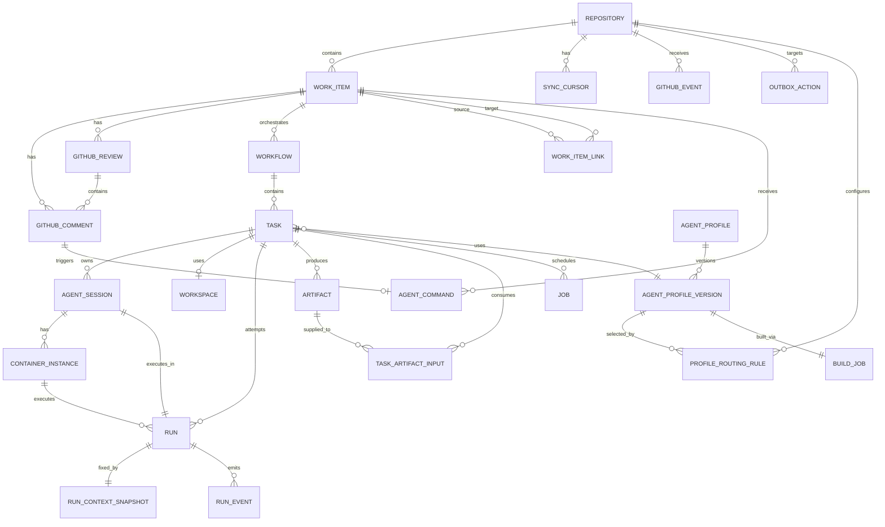

# Data Model

This is a conceptual model, not final SQL/DDL. Names and types can be adapted to the chosen language and persistence tooling.

## 1. ER diagram

## 2. Repository

Represents a configured GitHub repository.

Suggested fields:
- `id` (internal UUID)
- `github_repository_id` (unique external ID)
- `owner`
- `name`
- `full_name`
- `default_branch`
- `is_enabled`
- `configuration` (JSON)
- `created_at`, `updated_at`

Constraints:
- Unique `github_repository_id`.
- Unique normalized `full_name`.

## 3. WorkItem

Represents a GitHub Issue or Pull Request.

Fields:
- `id`
- `repository_id`
- `github_node_id`
- `number`
- `type` (`issue`, `pull_request`)
- `title`
- `body`
- `state` (`open`, `closed`)
- `author_login`
- `assignees` (synced metadata; not a V1 trigger)
- `labels` (synced metadata)
- `created_at_github`
- `updated_at_github`
- `closed_at_github`
- PR-only optional fields: `head_sha`, `base_sha`, `draft`, `merged_at`, `requested_reviewers`
- `last_synced_at`
- `cleanup_status`
- `closed_at_local`

Constraints:
- Unique `(repository_id, number)`.
- Unique `github_node_id`.

The Poller updates `title`, `body`, `labels`, and other synced fields whenever GitHub reports a newer `updated_at_github`; body edits trigger no Task by themselves. Existing `RunContextSnapshot`s stay immutable — a new Run assembles context from the currently synced state. A changed PR Head SHA never rewrites the SHA pinned on an already-created Review Task.

## 4. WorkItemLink

Represents an explicit relationship between two GitHub WorkItems, for example an Issue and a PR created to implement it.

Fields:
- `id`
- `source_work_item_id`
- `target_work_item_id`
- `relation_type` (`created_from`, `closes`, `related_to`, `blocks`, `custom`)
- `source` (`github_closing_reference`, `github_cross_reference`, `agent_action`, `manual`)
- `created_at`

Constraints:
- Unique `(source_work_item_id, target_work_item_id, relation_type)`.
- Prevent self-relations.

Link detection (V1): GitHub timeline events synced by the Poller are the authoritative source — a closed event whose commit carries closing keywords (closes/fixes…, with `commit_id`) creates relation `closes`; a cross-referenced event creates relation `related_to`. Branch naming conventions (`agent/issue-<n>`) are only a hint and never create a link on their own. If GitHub reports no explicit link, none is created; V1 has no separate manual link management (explicit agent/admin-created links are future work).

Closing one root WorkItem does not automatically close the related WorkItem or clean its Workflow in V1. `relation_type` in V1 is limited to `closes` and `related_to`; `created_from`, `blocks`, and `custom` are reserved for future extensions (decision 79).

## 5. GitHubComment

Fields:
- `id`
- `work_item_id`
- `github_comment_id`
- `kind` (`issue_comment` for Issue/PR conversation comments, `review_comment` for inline PR review comments)
- `author_login`
- `body` (always the latest synced version; edits are applied on sync)
- `created_at_github`
- `updated_at_github`
- `in_reply_to_comment_id` (nullable; local reference if known)
- `github_review_id` (nullable FK when this is an inline comment belonging to a submitted review)
- `path` (review comment, nullable)
- `commit_sha` (review comment, nullable)
- `diff_position` (nullable)
- `last_synced_at`

Constraints:
- Unique `(kind, github_comment_id)`.
- Deleted comments are tombstoned, not removed: `is_deleted`, `deleted_at` are set, and the record is excluded from future Task context (historical Tasks keep their archived context).
- Command parsing uses the immutable `AgentCommand.source_body_snapshot`, so later comment edits never change a processed command.

## 6. GitHubReview

Represents a submitted PR review (distinct from an inline review comment).

Fields:
- `id`
- `work_item_id` (must reference a Pull Request)
- `github_review_id` (unique external ID)
- `author_login`
- `state` (`pending`, `commented`, `approved`, `changes_requested`, `dismissed`)
- `body`
- `commit_sha`
- `submitted_at_github`
- `last_synced_at`

Unique `github_review_id`. Inline comments are stored as `GitHubComment` rows with `kind = review_comment` and linked through `github_review_id` when the API provides the relationship.

## 7. GitHubEvent

Normalized event detected by integration.

Fields:
- `id`
- `repository_id`
- `work_item_id` (nullable until resolved)
- `source`
- `external_event_id` (nullable where GitHub API lacks stable event ID)
- `dedupe_key` (stable external ID or deterministic fingerprint; unique within its source scope)
- `event_type`
- `payload` (JSONB)
- `occurred_at_github`
- `received_at`
- `processing_status`
- `processed_at`
- `processing_error`

Examples (normalized names, decision 78):
- `work_item_created`
- `work_item_updated`
- `work_item_closed` (with `close_reason = merged` for merged PRs)
- `issue_comment_created` / `issue_comment_updated` / `issue_comment_deleted`
- `review_comment_created` / `review_comment_updated` / `review_comment_deleted`
- `pull_request_review_submitted` / `pull_request_review_dismissed`
- `review_requested` / `review_request_removed`
- `pull_request_synchronized`

`source` enumerates the detection path: `rest_resource_sync`, `timeline_api`, `snapshot_diff`, `full_reconciliation`.

A merged Pull Request is treated as a closed WorkItem for lifecycle and cleanup purposes; no separate `pull_request_merged` event is required (`merged_at` is kept for history).

Deduplication should use stable external IDs where available, otherwise a deterministic fingerprint of source, event type, target, and relevant payload fields.

## 8. SyncCursor

Fields:
- `id`
- `repository_id`
- `stream` (issues, PRs, issue/PR conversation comments, PR reviews, PR inline comments, timeline events, etc.)
- `cursor_value` (opaque string or timestamp/ID)
- `last_success_at`
- `last_attempt_at`
- `last_error`
- `updated_at`

Unique `(repository_id, stream)`.

## 9. Workflow

One long-lived orchestration lifecycle per root WorkItem in V1. An Issue and a related PR are separate WorkItems and have separate Workflows; their relation is stored in `WorkItemLink`.

Fields:
- `id`
- `work_item_id`
- `status`
- `current_task_id` (nullable)
- `created_at`
- `started_at`
- `closed_at`
- `updated_at`
- `failure_reason`
- `initial_review_created_at` (nullable; set when the automatic initial review Task is created — deduplicates repeated `review_requested` requests within the PR lifetime)

Suggested status values:
- `active`
- `waiting_for_human`
- `failed`
- `closed`

A completed Task normally returns the long-lived Workflow to `waiting_for_human`. V1 does not require a separate permanent `completed` Workflow state because more Tasks may be requested later; root closure sets `closed`.

In V1, keep one long-lived Workflow per root WorkItem (create it on the first accepted task-producing command). A completed operation normally returns it to `waiting_for_human` rather than permanently completing the Workflow, so later commands can append Tasks. A Task that finally fails also returns it to `waiting_for_human`; `failed` is reserved for unrecoverable integrity/state-corruption failures (see state machines). A root close marks it `closed`. V1 enforces one Workflow per WorkItem with a full `UNIQUE(work_item_id)` constraint (no historical workflows; a partial "one active" index is future work). A subsequently reopened root WorkItem does not resurrect its Workflow: the record stays `closed`, no second Workflow is created, and commands for the reopened item are rejected with a recorded reason (decision 73).

## 10. Task

A discrete operation within Workflow.

Fields:
- `id`
- `workflow_id`
- `sequence`
- `type` (`plan`, `implement`, `review`, `test_design`, `custom`)
- `agent_profile_version_id`
- `status`
- `trigger_command_id` (nullable)
- `target_head_sha` (nullable; set by review Tasks — the pinned PR Head SHA this Task reviews)
- `target_base_sha` (nullable; set by review Tasks — the pinned Base SHA used to form the diff locally via Git, decision 64)
- Input artifacts are linked through `TaskArtifactInput` (many-to-many), not stored as an unbounded ID array.
- `created_at`
- `claimed_at`
- `started_at`
- `completed_at`
- `cancelled_at`
- `failure_reason`
- `retry_policy` (effective policy pinned at Task creation: defaults from `AgentProfileVersion.retry_policy`, optional Repository override; includes `max_automatic_retries`, backoff parameters, retryable error categories, and the run stages where automatic retry is allowed)

Unique `(workflow_id, sequence)`.

Tasks execute sequentially in V1. Explicit dependency relationships can be introduced if future workflows require branching.

A Task may reach a terminal `Blocked` state when its Run ends with `outcome = needs_human_input` (mid-run blocker; see 03 §2 and 06 §4, decision 72). The one-unfinished-Task invariant is additionally enforced in PostgreSQL by a partial unique index and transactional creation with a Workflow-row lock (decision 79, 02 §23).

## 10a. TaskArtifactInput

Join table describing which prior Artifacts are supplied to a Task.

Fields:
- `task_id`
- `artifact_id`
- `purpose` (for example `approved_plan`, `prior_diagnostic`, `test_cases`)
- `created_at`

Unique `(task_id, artifact_id)`.

## 11. AgentCommand

Fields:
- `id`
- `work_item_id`
- `github_comment_id` (FK to synchronized GitHubComment; unique for command processing)
- `author_login`
- `command_name` (`plan`, `code`, `review`, `test_cases`, `status`, `stop`, `help`, `retry`)
- `arguments` (JSONB)
- `parser_version`
- `status` (`received`, `authorized`, `queued`, `processed`, `rejected`, `failed`)
- `source_body_snapshot` (immutable comment text used for parsing; protected from later comment edits)
- `parsed_at`
- `processed_at`
- `rejection_reason`

Unique `github_comment_id` for recognized commands, or a unique external comment identifier plus parser version.

One comment produces at most one AgentCommand; only the original (unedited) comment version is parsed. `waiting` was removed: queue waiting is expressed by `Task`/`OrchestrationJob` states and human waiting by `Workflow.status = waiting_for_human`.

`arguments` is `{}` for every V1 command; text after the command line is preserved as user context and consumed by the Context Assembler — it is never parsed as positional arguments or flags (decision 79).

## 11a. Command semantics

The canonical V1 comment format is `@<bot-account> /<command> [arguments]`. The bot mention and slash command must be in the same comment. See `06-command-reference.md` for preconditions and full behavior.

- `plan`: create planner Task; produce plan/gaps/questions Artifact; Workflow waits for human.
- `code`: create coder Task implementing the latest successful plan Artifact; the command itself is the plan approval; commit/push branch and report result.
- `proceed` (historical name; replaced by `code`): create coder Task after the plan is approved; commit/push branch and report result.
- `review`: create reviewer Task for the pinned PR Head SHA (`target_head_sha`); fresh isolated workspace.
- `test-cases`: create test-designer Task; produce test case Artifact, without implementing/running tests by default.
- `debug`: the command was removed (no `debugger` profile exists).
- `retry`: repeat the last failed Task of the Workflow as a new Run with a new Pi session.
- `status`, `stop`, `help`: control/information commands; do not create agent Tasks.

Commands are deduplicated by GitHub comment ID. Unauthorized/invalid commands are persisted with a rejection reason.

## 12. AgentProfile and AgentProfileVersion

`AgentProfile`:
- `id`
- `name` (unique)
- `description`
- `is_enabled`
- `created_at`, `updated_at`

`AgentProfileVersion`:
- `id`
- `agent_profile_id`
- `version`
- `container_image`
- `source_directory` — Git directory `config/agents/<profile>/` containing `profile.yaml` (Dockerfile, `prompts/`, `skills/`) plus `source_commit_sha`, `config_snapshot`, `config_hash` (immutable snapshot pinned at version creation)
- `runtime_type` (Pi initially)
- `system_prompt`
- `skills_configuration`
- `mcp_configuration`
- `tools_configuration`
- `environment_configuration` — secret references only (e.g. `github_agent_pat`); values live outside Git/PostgreSQL
- `resource_configuration`
- `capabilities`
- `retry_policy` (profile-level retry defaults)
- `permission_policy` (tool/MCP allow-list; unattended mode denies everything else)
- `bridge_configuration` (Runtime Bridge version, heartbeat/event cadence)
- `startup_timeout`, `max_run_duration` (execution-limit defaults)
- `state` (`draft`, `building`, `ready`, `build_failed`, `disabled`)
- `image_digest` / build metadata (including the `build_id` BuildJob reference)
- `created_at`

Unique `(agent_profile_id, version)`. Creating a version records state `draft`; the image build it triggers is asynchronous (decision 81): the Orchestrator creates a durable BuildJob (§12b), sets the version `building`, dispatches `POST /internal/builds` to the Build Worker (local Docker build on the execution host, tag `agent-<profile-name>:v<version>`, no external registry in V1), polls `GET /internal/builds/{buildId}`, and on a validated success records `image_digest` / build metadata and sets the version `ready`. Only a real build failure produces terminal `build_failed`; network errors and temporary Worker unavailability keep the version `building` under exponential-backoff retry. Only `ready` versions may be selected for a Task. The per-field configuration values below (system prompt, skills, MCP, tools) are recorded in the immutable `config_snapshot` for lineage and display; at runtime the baked image is the sole effective configuration (decision 56).

Profile secrets live outside Git and PostgreSQL in host-managed files (for example `/etc/pi-agent/secrets/`, restricted permissions); `profile.yaml` and the stored snapshot hold references only (e.g. `github_agent_pat`). The Runtime mounts a profile's required secrets read-only in-container at `/run/secrets/<name>`; secrets never travel via environment variables or image layers, and each profile receives only the secrets it needs (a read-only sync PAT for the Poller, write-capable PATs for agent MCP/Git operations, both repository-scoped).

A Task references a profile version, so later profile changes do not retroactively alter task configuration.

Profile versions are created exclusively through the configuration plane: the Config Loader reads `config/agents/<profile>/profile.yaml` and creates the `AgentProfile`/`AgentProfileVersion` rows (state `draft`); the Orchestrator then drives the build through the Build Worker (local build, tag `agent-<profile>:v<n>`) and sets `ready` only after validating the polled result — the Build Worker never writes the control-plane database (01 §2, decisions 55–56, 81). The image is the sole source of Pi runtime configuration in V1: the Pi version is pinned at build time, and the profile's Pi configuration (settings, MCP, extensions, skills, prompts, system instructions) is baked read-only at `/opt/pi-agent/profile` and selected with `PI_CODING_AGENT_DIR`; LLM model/provider selection is deferred to V2. Each version additionally carries a mandatory `max_context_tokens` — the Context size limit for Task input; it must fit the profile model's context window with a reserve for the answer and is enforced by the Context Assembler (decision 63).

## 12a. AgentProfileRoutingRule

Maps an operation to a profile, optionally scoped to a repository.

Fields:
- `id`
- `repository_id` (nullable; null means global default)
- `task_type` (`plan`, `implement`, `review`, `test_design`)
- `agent_profile_version_id`
- `priority`
- `is_enabled`

Unique rule scope should be enforced for a given repository/task type/priority. This makes profile selection configurable without hardcoding profile names in Orchestrator.

V1 ships a seeded global rule set (`repository_id = NULL`); repository-specific rules override it, and the selected `AgentProfileVersion` is pinned on the Task at creation. When no matching rule exists, or the selected profile is not `ready`/enabled, the command is rejected before any Task is created with reason `agent_profile_not_configured`.

## 12b. BuildJob

Durable record of one AgentProfileVersion image build, created by the Orchestrator before first dispatch (decision 81):
- `id` — the unique `buildId`, generated and persisted by the Orchestrator before dispatch; dispatch and status polling reference the same id
- `agent_profile_version_id`
- `dispatch_payload` — profile version, configuration snapshot, source commit SHA, build context reference (all also pinned on the version row; recorded for lineage)
- `state` — Orchestrator-side dispatch/polling progress (distinct from the version status; the outcome is validated before `AgentProfileVersion.state` changes)
- `attempts`, `next_retry_at` — exponential-backoff retry bookkeeping for dispatch/polling failures
- `image_tag`, `image_digest`, `build_log_reference` — validated result recorded on completion; `image_digest` mirrors into `AgentProfileVersion`
- `created_at`, `updated_at`

One BuildJob per AgentProfileVersion; retries reuse it with the same `buildId` (idempotent worker-side). On Orchestrator restart the reconciler resumes unfinished BuildJobs (resume polling or redispatch, same `buildId`). The Worker keeps its own durable local build-job state for the same `buildId`; build-job state in PostgreSQL is updated only by the Orchestrator.

## 13. AgentSession

One Pi session per Run attempt. The session is not shared across Tasks, Runs, or Agent Profiles: a retry creates a new Run and a new Pi Session; the previous session is retained until cleanup. A new Task always gets a new session. Each AgentSession is one-shot and 1:1 with its Run (`run_id` unique): it is never pooled, reassigned, or reused — a terminated Session never returns to service (decision 57). Recovery after a Runtime restart may reopen the backing files of the same Run only. The DB record is created by the Orchestrator (status `provisioning`) when the Run is prepared; the Runtime API provisions the backing files and writes runtime metadata back into the record.

Fields:
- `id`
- `run_id` (unique; the single Run this session has ever executed — AgentSession is 1:1 with Run)
- `task_id` (denormalized reference for queries)
- `agent_profile_version_id`
- `runtime_session_id`
- `session_file_path` (host-relative/managed path)
- `status`
- `created_at`
- `last_activity_at`
- `last_heartbeat_at`
- `file_deleted_at`
- `storage_status` (`available`, `deleted`, `missing`, `cleanup_pending`)
- `metadata`

Session record persists after its files are deleted.

## 14. Run

One execution attempt of a Task.

Fields:
- `id`
- `task_id`
- `agent_session_id`
- `attempt_number`
- `status`
- `container_instance_id` (nullable)
- `started_at`
- `completed_at`
- `last_heartbeat_at`
- `last_progress_at`
- `exit_code`
- `error_code`
- `error_message`
- `result_summary`
- `log_storage_reference`
- `log_size_bytes`
- `logs_completed_at`
- `logs_deleted_at`

Unique `(task_id, attempt_number)`. `attempt_number` is assigned by the Orchestrator when the Run is created; agents never change it.

`Run.result_summary` is a short per-attempt diagnostic intended for `/status` and failure notifications; full results live in Artifacts — the summary does not duplicate artifact content (decision 79).

## 14a. RunContextSnapshot

Immutable record of what the Context Assembler assembled for one Run (decision 63).

Fields:
- `id`
- `run_id` (unique — one snapshot per Run)
- `task_id`
- `content_hash`
- `included_sources` (JSON)
- `excluded_sources` (JSON, with the pruning reason per element)
- `created_at`

Snapshots are never modified. Pruning priority when the context exceeds limits: never drop the command, mandatory inputs, or the last approved plan; keep recent user answers and unfinished discussions first; drop older/less-significant comments; for reviewers keep unresolved review threads. No silent truncation: if mandatory input cannot fit, the Run is not started and the Task fails with `context_too_large`.

## 15. ContainerInstance

Fields:
- `id`
- `agent_session_id`
- `run_id` (nullable)
- `komodo_deployment_id`
- `deployment_name`
- `host_id`
- `container_image`
- `desired_state` (`running`, `stopped`, `removed`)
- `observed_state`
- `created_at`
- `last_started_at`
- `last_stopped_at`
- `removed_at`

A container is replaceable and is stopped after Task completion. The stopped deployment may be recreated for a retry from the same persistent storage. V1 uses exactly one configured execution host; `host_id` records where the container was created. Containers and the Workflow storage tree (workspaces, sessions, run logs) are removed when their root WorkItem closes.

## 16. Workspace

Fields:
- `id`
- `task_id` (unique; Workspace belongs to one Task)
- `work_item_id` (denormalized reference for queries)
- `repository_id`
- `storage_kind` (`host_path` — default in V1, `docker_volume`, future object store)
- `storage_reference`
- `repo_path`
- `branch_name`
- `base_sha`
- `current_sha`
- `access_mode` (`read_write`, `read_only`)
- `status`
- `created_at`
- `last_used_at`
- `deleted_at`

Every Task gets a task-specific Workspace. Storage persists after the Task container stops and is deleted when the root WorkItem is closed. Reviewer always receives a fresh workspace at the pinned reviewed Head SHA, separate from coder workspaces, read-only where possible.

V1 uses plain directories on persistent host storage, not named Docker volumes: `/var/lib/pi-agent/workflows/{workflow_id}/tasks/{task_id}/workspace` for the workspace and `/var/lib/pi-agent/workflows/{workflow_id}/runs/{run_id}/` for `pi-session/` and `logs/` per Run. Names use internal UUIDs; containers receive the directories they need via mounts. Automated backups of these directories are not provided in V1 (only PostgreSQL and profile configuration are backed up; unpushed coder work on the execution host is an accepted risk); cleanup happens at root closure, with no age-based cleanup of open Workflows, and periodic reconciliation removes orphaned directories.

A coder Task works on `agent/issue-<number>` based on the default-branch HEAD captured at first provision (`base_sha`); later coder Tasks in the same Workflow, and retries, continue the existing agent branch. The Workspace DB record is created by the Orchestrator on the Task's first Run and is reused by retries; the Runtime API provisions the physical storage.

Reviewer workspaces are provisioned from the pinned pair `target_head_sha`/`target_base_sha` — the Runtime obtains both Git revisions and forms the diff locally (GitHub `pulls/{n}/files` is not used as the diff source, decision 64). Fork-PR heads are checked out from the PR head ref of the base repository at the pinned SHA in a fresh read-only workspace; fork code is treated as untrusted — its scripts/builds/tests are never run automatically (decision 74). The coder `base_sha` is captured at first provision; V1 performs no automatic rebase onto a moved default branch — a manual rebase before PR creation may be required (accepted limitation, decision 72).

## 17. Artifact

Fields:
- `id`
- `task_id`
- `workflow_id`
- `type` (`plan`, `test_cases`, `review_report`, `implementation_summary`, `log_reference`, `custom`)
- `format` (`markdown`, `json`, `text`, `file_reference`)
- `content` or `storage_reference`
- `metadata`
- `created_at`

Artifacts provide explicit handoff between agents. Avoid relying only on one agent's conversation history. Plan Artifacts carry no approval status in V1 — approval of the latest successful plan is expressed by the command that consumes it (`/code`, see 06 §4, decision 80). Since artifacts are immutable, a plan revision always means a new planning Task and a new Artifact.

V1 storage rules: content is stored inline in PostgreSQL; artifacts are immutable after creation; handoff happens by loading `TaskArtifactInput` artifacts into the next Task's input. Limits: 256 KiB per artifact, 512 KiB of artifact content total per Task input (plus the profile's mandatory `max_context_tokens`, 02 §12, decision 63); no silent truncation — oversized output must be split or shortened by the agent. Supported formats in V1: `markdown`, `json`, `text`; `file_reference` is future. An Artifact of `type = log_reference` points to the Run log directory on host storage; its content is not copied into PostgreSQL.

## 18. RunEvent

Fields:
- `id`
- `run_id`
- `event_id` (runtime-generated idempotency key)
- `type`
- `payload`
- `occurred_at`
- `received_at`

Unique `(run_id, event_id)`.

Events (normalized names, mapped from pi RPC events — 04 §4, decisions 58, 68): `agent_started`, `turn_started`, `turn_completed`, `assistant_output` (aggregated text deltas), `tool_started`, `tool_progress`, `tool_completed`, `agent_settled`, `heartbeat`, `permission_blocked`, `artifact_produced`, `completed`, `failed`, `cancelled`. Progress counts: non-empty assistant text deltas (aggregated), tool-execution start/update/end, turn completion, artifact creation; heartbeat, thinking deltas, queue updates, and bare process liveness never count as progress. `permission_blocked` is not progress and resets no timers.

## 19. OrchestrationJob

Durable queue record.

Fields:
- `id`
- `task_id`
- `job_type`
- `status` (`pending`, `processing`, `completed`, `failed`, `cancelled`)
- `priority`
- `attempts`
- `available_at`
- `locked_until`
- `locked_by`
- `last_error`
- `created_at`
- `updated_at`

Use transactional claiming/locking and retry/backoff. Concurrency: each Workflow holds at most one unfinished Task; a global cap `max_concurrent_runs` (default 10, Orchestrator configuration) bounds the total number of concurrently running Runs across Workflows — extra jobs wait in the queue. Queue order: FIFO by `available_at`, then `priority`; `/stop` is a control action handled immediately outside the queue. The cap counts Runs in states `Claimed`, `Starting`, `Running`, and `Stopping` (awaiting confirmed stop of processes/container); the slot is released only at the Run's terminal state plus confirmed stop — queued/pending work occupies no slot (decision 75).

## 20. OutboxAction

Reliable external write/action queue. Used only for orchestration-owned comments: system notifications (final Task failures, command rejections, cancellation confirmations) and control-command replies (`/status`, `/help`, `nothing to stop`). Agent GitHub operations (plan comments, coder summaries, reviews) are performed by agents via GitHub MCP and do not go through the Outbox.

Fields:
- `id`
- `repository_id`
- `work_item_id`
- `task_id` (nullable)
- `action_type` (`comment` in V1 — the Outbox publishes orchestration-owned system notifications only; agent GitHub writes go through GitHub MCP and never through the Outbox)
- `payload`
- `status`
- `attempts`
- `available_at`
- `completed_at`
- `last_error`
- `idempotency_key`
- `created_at`

Unique `idempotency_key`.

Delivery policy (V1, decision 67): transient failures (network, 5xx, 429, rate-limit 403) retry with exponential backoff — max interval 1 hour, total retry window 24 hours; permanent errors (401, regular 403, 404, 422) and transient exhaustion after 24 hours move the action to a retained `dead_letter` state (payload, attempts, and last error kept; surfaced in host logs and health status). Duplicate control: the delivered comment carries an invisible HTML-comment marker containing `idempotency_key`; after an ambiguous timeout the Outbox checks existing comments for the marker before re-sending; a single dispatcher owns one action at a time via a DB lease. The V1 guarantee is at-least-once delivery with best-effort deduplication.

## 21. Authorization configuration

Desired authorization configuration lives in YAML (01 §2, decisions 55, 66): `system.yaml` holds the global bot identity (`github.bot_login`) and command-grammar/parser settings; `repositories.yaml` holds per repository: the allowlist of permitted logins, permitted commands, permitted WorkItem types, and the authorization policy. The Config Loader validates the configuration at startup — including checking via `GET /user` that the PAT identity matches `github.bot_login`; a mismatch is a configuration error.

Contents per repository:
- Minimum GitHub permission required (`write`).
- Allowlist of permitted logins: enabled by default and seeded with the repository owner's account; a non-empty allowlist requires both Write permission and membership; an explicitly emptied allowlist disables list filtering, leaving the Write-permission baseline.
- Permitted commands and WorkItem types.

Authorization mechanics (decision 66):
- Write permission is verified with `GET /repos/{owner}/{repo}/collaborators/{username}/permission`; `write` and `admin` are accepted, `maintain` is treated as `write`, `triage` as `read`.
- Results are cached for at most 60 seconds; a stale cache is rechecked when a queued Task is claimed.
- GitHub `404` for the collaborator lookup rejects the command; transient GitHub errors (5xx, network, rate limits — honoring `Retry-After`/`X-RateLimit-Reset`) leave the command `received` and defer the check.
- A PAT without sufficient scope to perform the check is a system configuration error, not a per-user rejection.

Authorization is evaluated when the command is processed. Removing a user from the allowlist prevents future commands; it does not interrupt an already-running Task.

## 22. Root closure and retention

When the root WorkItem closes:
- Workflow is closed/cancelled.
- No new tasks may be scheduled.
- Active runs are stopped.
- Containers are removed.
- The Workflow storage tree (workspace directories, per-Run `pi-session/` and `logs/`) is deleted.
- DB records are retained and marked with storage cleanup/deletion timestamps/status.

PostgreSQL retention in V1: no automatic deletion of any orchestration history — Workflows, Tasks, Runs, Artifacts, comments, reviews, events, tombstones, and audit records are kept indefinitely; regular backups and database size monitoring are mandatory; archival and partitioning are future work (decision 76).

## 23. Recommended indexes

- WorkItem: `(repository_id, number)` unique; `github_node_id` unique.
- GitHubComment: `(kind, github_comment_id)` unique; `(work_item_id, created_at_github)`.
- AgentSession: `run_id` unique (one-shot sessions, decision 57).
- RunContextSnapshot: `run_id` unique.
- GitHubEvent: `(repository_id, processing_status, received_at)`; `(source, dedupe_key)` unique where applicable.
- SyncCursor: `(repository_id, stream)` unique.
- Workflow: `(work_item_id)` unique for one long-lived V1 Workflow; `(status, updated_at)`.
- WorkItemLink: `(source_work_item_id, target_work_item_id, relation_type)` unique.
- Task: `(workflow_id, sequence)` unique; `(status, created_at)`; `trigger_command_id` unique where non-null if one command creates at most one Task; plus `ux_task_one_unfinished_per_workflow` — partial unique index on `task(workflow_id)` WHERE `status` IN (`Queued`, `Claimed`, `Starting`, `Running`); Task/Job creation additionally locks the Workflow row (`SELECT … FOR UPDATE`) and rechecks the invariant (decision 79).
- Workspace: `task_id` unique.
- Run: `(task_id, attempt_number)` unique.
- AgentCommand: comment ID unique; `(status, created_at)`.
- OrchestrationJob: `(status, available_at, priority)`.
- OutboxAction: `(status, available_at)`, idempotency key unique.
