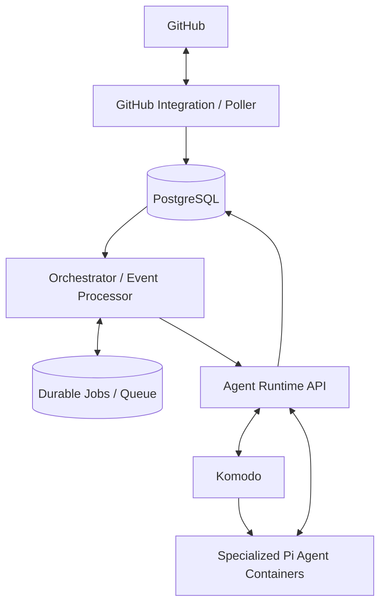
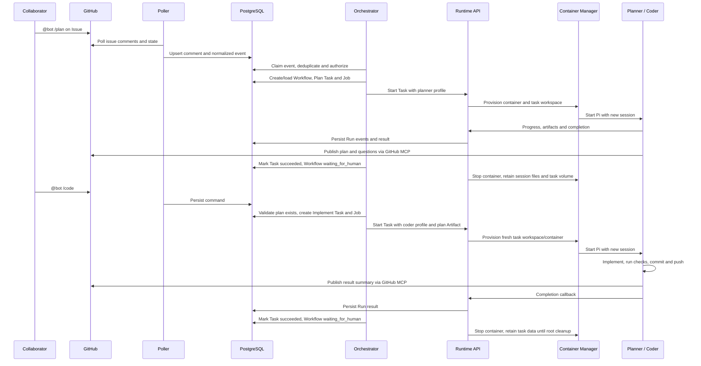

# Architecture and Flows

## 1. Goal and constraints

Build a GitHub-native multi-agent system. Users control agents through GitHub Issues, Pull Requests, and comments rather than by interacting with Pi in a terminal.

The system supports multiple specialized Pi agents. Each profile may have its own Docker image, skills, MCP servers, tools, prompts, environment, and resource configuration.

The current repository is a proof of concept. It demonstrates technical feasibility (GitHub polling, Pi sessions, GitHub MCP interaction, container spawning/Komodo), but its code, API, folder structure, runtime implementation, language, framework, and persistence approach are not constraints. They may be redesigned or fully replaced.

## 2. Logical architecture

### GitHub Integration / Poller

- Polls configured repositories on a configurable interval; 30–60 seconds is a reasonable initial setting, not a fixed requirement.
- Synchronizes Issues, PRs, issue comments, PR conversation comments, inline review comments, reviews, review request additions/removals, comment edits/deletions, relevant events, and commit metadata.
- Comment edits update the stored body; deleted comments are tombstoned, not removed (see 02).
- Persists normalized records/events and per-stream sync cursors in PostgreSQL.
- Uses stable external IDs or deterministic fingerprints to deduplicate data.
- Advances a cursor only after the fetched page/batch is durably saved.
- No public IP or inbound GitHub webhook is required for V1.

### Orchestrator

- Consumes persisted events and commands.
- Parses commands and checks target type, permissions, and Workflow state.
- Creates Workflows, Tasks, Runs, and durable queue jobs.
- Selects a versioned Agent Profile.
- Enforces one active execution within a single workflow.
- Owns business-state transitions and decides what happens after completion, failure, timeout, cancellation, a human response, or root closure. A final Task failure (retries exhausted) returns the Workflow to `waiting_for_human`; Workflow `failed` is reserved for unrecoverable integrity/state-corruption failures.
- Publishes orchestration-owned system notifications (final Task failures, command rejections, cancellation confirmations) through the durable Outbox. Agent GitHub operations themselves are performed by the agents via GitHub MCP under profile permissions.

### Agent Runtime API

- Creates a new Pi session for each Task.
- Provisions task-specific workspaces and mounts persistent storage.
- Creates/starts/stops container deployments via Komodo.
- Sends task instructions and inputs to Pi.
- Callbacks are emitted by the Runtime Bridge — a process inside the agent container that launches Pi in `--mode rpc`, reads the JSONL event stream, and posts events, a periodic heartbeat (default 30 seconds), completion, and failure callbacks to this API.
- Receives progress, heartbeat, artifact, completion, and failure callbacks through routes on this same API; a separate webhook receiver service is not required.
- Reconciles desired state in PostgreSQL with actual Komodo/container state.
- Does not decide business workflow transitions.

### Komodo

Komodo - the container management layer. The Runtime API abstracts Komodo from the Orchestrator. Komodo + Komodo Api - single docker-compose

## 3. Agent profiles

Initial deployment ships a single profile: Planner.

Planned profiles (added later via configuration):

| Profile | Purpose | Default behavior |
|---|---|---|
| `planner` | Analyze requirements and repository; identify gaps; prepare implementation plan | Read/analyze, no code changes |
| `coder` | Implement approved work (enabled in a later phase) | Write code, run checks, commit and push branch |
| `reviewer` | Review a PR at a fixed Head SHA (enabled in a later phase) | Read-only review; submit findings |
| `test-designer` | Design test scenarios/cases (enabled in a later phase) | Produce test artifacts; do not implement tests by default |

No `debugger` profile is planned; `/debug` is parked (see 09-open-questions.md). Commands that select a missing, not-ready, or disabled profile are rejected before a Task is created (`agent_profile_not_configured`).

Profile configuration is versioned and can include image, Pi runtime config, system prompt, skills, MCP servers, tool permissions, environment references, capabilities, retry defaults, execution-limit defaults, and resource limits. A version carries an unattended permission allow-list: approved tools/MCP operations run automatically, everything else is denied — no interactive dialogs in agent runs.

Profile version images are built once when the version is created (local Docker build on the single execution host, tag `agent-<profile>:v<version>`, no external registry in V1) and only versions in the `ready` state are selectable. Changing the Dockerfile, dependencies, or configuration requires a new version. A Task pins one profile version so configuration changes do not alter an existing task.

Adding a profile should normally be configuration work, not a change to orchestration logic. Repository convention: keep each agent in its own directory (for example `agents/planner/`, `agents/coder/`, `agents/reviewer/`, `agents/test-designer/`), with its own Dockerfile/build context, Pi config, prompts, skills, and MCP configuration. The exact file layout can evolve, but profiles must not be entangled in one shared agent directory.

## 4. Data ownership

- GitHub is canonical for Issues, PRs, comments, reviews, branches, and commits.
- PostgreSQL is the source of truth for synchronized GitHub records, commands, workflows, tasks, runs, profile versions, state transitions, jobs, and artifact metadata.
- Pi session files live on persistent Docker-host storage in V1. Every Run attempt uses a new Pi session; a retry creates a new session.
- Artifacts are stored inline in PostgreSQL and passed to the next Task through its input; there is no shared artifact volume in V1.
- Agent containers have no host shell access (no host-bridge capability).
- Each Task has its own persistent workspace volume/host storage. The container can be stopped and restarted while the task data remains.
- Reviewer workspace is fresh and isolated from coder workspace.
- Agent profiles may expose selected GitHub MCP tools and other MCP servers. Agents are responsible for performing GitHub operations explicitly permitted by their profiles. The Agent Runtime records execution events and results, which are persisted by the Orchestrator. The Orchestrator remains responsible for workflow state, task scheduling, container lifecycle, command handling, and system-level notifications.
- Komodo owns actual deployment/container state; PostgreSQL stores desired and last observed state.

## 5. WorkItem, Workflow, Task, Session, Run, Container

These are separate concepts:

- **WorkItem**: GitHub Issue or PR.
- **Workflow**: long-lived orchestration lifecycle for one root WorkItem.
- **Task**: one unit of work such as plan, implementation, review, test design, or debugging.
- **AgentSession**: a new Pi session for each Task.
- **Run**: one attempt to execute a Task; retry creates another Run.
- **Workspace**: persistent task-specific repository working copy/storage.
- **ContainerInstance**: replaceable container deployment used to execute a Run.

One Issue and a PR created from it are separate WorkItems and have separate Workflows. Store their relationship explicitly (for example, `WorkItemLink` with `closes`, `created_from`, or `related_to`). Closing the Issue must not silently close an independently open PR Workflow unless a future explicit policy says so.

## 6. Issue command flow: plan → human approval → code

Canonical comment syntax is `@<bot-account> /<command>`. The bot mention and command must be in the same comment for V1.

### Issue command rules

- Issue assignment to the bot is not required and is not used as a V1 trigger or execution switch; assigning/unassigning the bot does not start or interrupt a Task.
- An Issue command requires bot mention + recognized slash command.
- Caller must have GitHub Write permission and pass an optional configured allowlist restriction.
- Any ordinary Issue comment is synchronized but does not start an agent without a recognized command.
- `/plan` creates a `planner` Task and returns plan, gaps, and questions.
- `/code` creates a `coder` Task only after a successful plan Artifact (the latest successful planning Task); sending `/code` itself is the approval of that plan (unless repository configuration explicitly permits implementing without a plan). Enabled once the coder phase ships.
- `/test-cases` creates a `test-designer` Task and produces test case artifacts; it does not imply implementation or execution of tests.
- `/debug` is parked: no `debugger` profile is planned (see 09).
- `/status`, `/stop`, `/help`, and `/retry` are control/recovery commands and do not create new agent Tasks.
- Every Run attempt has a distinct Pi session. Tasks never share Pi conversation history.
- At most one unfinished Task may exist per Workflow: a further command for that Workflow is rejected at admission; commands for other Workflows are queued while execution capacity is busy.
- Workflow is returned to `waiting_for_human` after each completed, cancelled, or finally failed Task; it becomes `failed` only for an unrecoverable integrity/state-corruption failure and `closed` when the root WorkItem closes. Final failures are announced by the Orchestrator via the Outbox.

See [Command Reference](06-command-reference.md) for complete preconditions and effects of every command.

## 7. Pull Request flow

### Initial review

- The first review is triggered when GitHub reports that the bot account has been requested as a reviewer on a PR.
- Poller persists the `review_requested` event and current PR snapshot.
- Orchestrator creates one initial review Task for that request/PR state; exactly one automatic initial review Task exists per PR/Workflow lifetime, and removing the review request before execution starts cancels a not-yet-started Task.
- Reviewer gets a fresh workspace at the PR Head SHA, separate from any coder workspace, and read-only where possible.
- Reviewer inspects the diff and context, stores a review Artifact, and submits a review plus inline comments through Github MCP.

### Subsequent review

- `pull_request_synchronize` (new commit) updates PR data only; it does not trigger another review automatically.
- A subsequent review is started only when a collaborator explicitly comments `@<bot-account> /review`.
- Each explicit command is a new requested review, even if the Head SHA has not changed. Duplicate delivery of the same comment must not duplicate execution.
- Each review Task pins the PR Head SHA at Task creation (`target_head_sha`). If the Head SHA changed before a queued Task starts, the Task is cancelled (`review_head_changed_before_execution`) and a system notification asks for an explicit `/review` again. Results stay traceable to the exact revision.

## 8. Comment handling

Persist all relevant comments, including Issue comments, PR conversation comments, and inline review comments. The context supplied to a Task should include relevant prior discussion and, for PR review, the existing review threads/comments. In V1, a comment starts an agent only if it contains the bot mention and a recognized command. Ordinary replies and mentions without recognized commands remain context, not implicit instructions. A future enhancement may support free-form natural-language replies/continued conversation with the bot; whether that is required in V1 remains an open product decision.

## 9. Sequential scheduling

V1 has one execution slot (`max_concurrent_runs = 1`) per Workflow. At most one unfinished Task may exist per Workflow; further commands for that Workflow are rejected at admission.

The final V1 concurrency wording (per-Workflow slot vs an additional global cap) is still open — see [09-open-questions.md](09-open-questions.md) Q1.

Use transactional claiming/leases in PostgreSQL so that multiple Orchestrator workers cannot claim the same job.

## 10. Workspace, container, and session lifecycle

- Every Task has its own Pi session and workspace.
- A container is an execution resource, not the durable identity of the Task.
- When a Task finishes, stop its container. Retain session files and the task workspace volume on persistent Docker-host storage so the task can be inspected or resumed according to retry policy.
- Every Run attempt uses a new Pi session (a retry creates a new Run and a new session for the same Task). Workspace reuse follows task-type policy: a retry may reuse the Task workspace if it remains valid, a coder Task continues its existing agent branch, and a reviewer always gets a fresh workspace.
- A Reviewer always receives a fresh workspace at the review SHA.
- The coder must save changes, commit, push a branch, and report the branch/result in the Issue before marking implementation successful.
- Automatic PR creation is not assumed in V1. Whether coder creates a PR should be a separate explicit command or repository setting.

## 11. Root WorkItem closure and cleanup

When a root Issue or PR closes:
1. Prevent new commands/tasks for that root item (except read-only status/help if desired).
2. Cancel active/queued Tasks and stop active Runs.
3. Stop and remove associated containers/Komodo deployments.
4. Delete task workspace volumes.
5. Delete Pi session files.
6. Mark deletion/cleanup timestamps and storage status in PostgreSQL.
7. Preserve DB records, comments, events, task/run history, and artifact metadata.

Issue and its related PR are separate roots. Closing one does not automatically clean up the other unless an explicit future lifecycle policy is introduced.

## 12. Polling, heartbeat, and reconciliation

- Polling interval is configurable; 30–60 seconds is a reasonable initial value.
- Maintain independent cursors per repository/data stream.
- Poller saves normalized data/events before advancing a cursor.
- Runtime heartbeat confirms liveness; progress indicates meaningful task activity. They are different signals.
- Track runtime heartbeat, session-file activity, RPC/request activity, run events, and process/tool activity separately.
- Idle timeout (default 60 minutes): the container is alive (the Runtime Bridge heartbeat continues) but there is no observable activity at all — no events, no progress, no completion, no session update. It triggers reconciliation, never an immediate stop. Heartbeat alone proves liveness and does not count as task progress. Before stopping an apparently idle container, inspect active child processes/commands so a long-running test or build is not killed merely because it emits no text.
- Separate wall-clock limit: `max_run_duration` (default 4 hours) ends the Run with `TimedOut` regardless of heartbeat or progress. A separate `startup_timeout` (default 10 minutes) fails a Run whose container/agent never became ready with `startup_timeout`. A `permission_blocked` event is not progress and resets no timer.
- Reconciler compares PostgreSQL desired state with Komodo/container observed state. It investigates stale/idle runs before stopping or retrying them.
- Lost callback, API restart, container exit, and Komodo outage must be recoverable through persisted state and reconciliation.

## 13. Deployment topology and technology neutrality

The logical components may run in one Compose project initially or in separate Compose projects/hosts later. A control-plane host may run PostgreSQL, Poller, Orchestrator, and Runtime API; an execution host may run Komodo/Periphery and Pi containers. Persistent session/workspace storage belongs to the execution Docker host and is managed as Docker volumes/host storage there; do not assume the control-plane machine can access its local filesystem paths. If hosts are separate, the Runtime API and agent containers need private network reachability for management and callbacks (for example, same LAN or a private VPN). This does not require a public IP or inbound GitHub webhook. V1 uses exactly one configured execution host; host selection, balancing, and failover across hosts are future work. The exact Compose split is a deployment choice, not a domain-model dependency.

No language, framework, ORM, or API technology is selected. The existing proof-of-concept implementations may be replaced.
