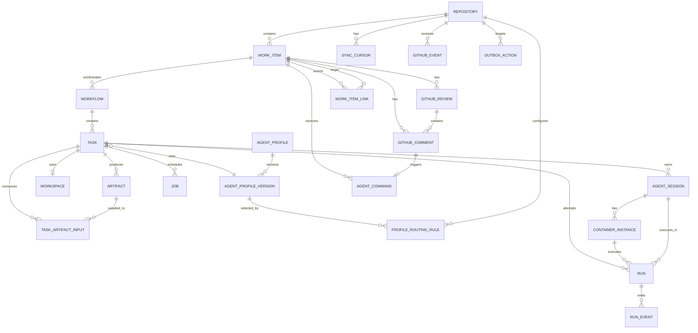

# Data Model

This is a conceptual model, not final SQL/DDL. Names and types can be adapted to the chosen language and persistence tooling.

## 1. ER diagram

## 2. Repository

Represents a configured GitHub repository.

Suggested fields:
- `id` (internal UUID)
- `github_repository_id` (unique external ID)
- `owner`
- `name`
- `full_name`
- `default_branch`
- `installation_id` (if GitHub App is used)
- `is_enabled`
- `configuration` (JSON)
- `created_at`, `updated_at`

Constraints:
- Unique `github_repository_id`.
- Unique normalized `full_name`.

## 3. WorkItem

Represents a GitHub Issue or Pull Request.

Fields:
- `id`
- `repository_id`
- `github_node_id`
- `number`
- `type` (`issue`, `pull_request`)
- `title`
- `body`
- `state` (`open`, `closed`)
- `author_login`
- `assignees` (synced metadata; not a V1 trigger)
- `labels` (synced metadata)
- `created_at_github`
- `updated_at_github`
- `closed_at_github`
- PR-only optional fields: `head_sha`, `base_sha`, `draft`, `merged_at`, `requested_reviewers`
- `last_synced_at`
- `cleanup_status`
- `closed_at_local`

Constraints:
- Unique `(repository_id, number)`.
- Unique `github_node_id`.

## 4. WorkItemLink

Represents an explicit relationship between two GitHub WorkItems, for example an Issue and a PR created to implement it.

Fields:
- `id`
- `source_work_item_id`
- `target_work_item_id`
- `relation_type` (`created_from`, `closes`, `related_to`, `blocks`, `custom`)
- `source` (`github_closing_reference`, `branch_metadata`, `agent_action`, `manual`)
- `created_at`

Constraints:
- Unique `(source_work_item_id, target_work_item_id, relation_type)`.
- Prevent self-relations.

Closing one root WorkItem does not automatically close the related WorkItem or clean its Workflow in V1.

## 5. GitHubComment

Fields:
- `id`
- `work_item_id`
- `github_comment_id`
- `kind` (`issue_comment` for Issue/PR conversation comments, `review_comment` for inline PR review comments)
- `author_login`
- `body` (always the latest synced version; edits are applied on sync)
- `created_at_github`
- `updated_at_github`
- `in_reply_to_comment_id` (nullable; local reference if known)
- `github_review_id` (nullable FK when this is an inline comment belonging to a submitted review)
- `path` (review comment, nullable)
- `commit_sha` (review comment, nullable)
- `diff_position` (nullable)
- `last_synced_at`

Constraints:
- Unique `(kind, github_comment_id)`.
- Deleted comments are tombstoned, not removed: `is_deleted`, `deleted_at` are set, and the record is excluded from future Task context (historical Tasks keep their archived context).
- Command parsing uses the immutable `AgentCommand.source_body_snapshot`, so later comment edits never change a processed command.

## 6. GitHubReview

Represents a submitted PR review (distinct from an inline review comment).

Fields:
- `id`
- `work_item_id` (must reference a Pull Request)
- `github_review_id` (unique external ID)
- `author_login`
- `state` (`pending`, `commented`, `approved`, `changes_requested`, `dismissed`)
- `body`
- `commit_sha`
- `submitted_at_github`
- `last_synced_at`

Unique `github_review_id`. Inline comments are stored as `GitHubComment` rows with `kind = review_comment` and linked through `github_review_id` when the API provides the relationship.

## 7. GitHubEvent

Normalized event detected by integration.

Fields:
- `id`
- `repository_id`
- `work_item_id` (nullable until resolved)
- `source`
- `external_event_id` (nullable where GitHub API lacks stable event ID)
- `dedupe_key` (stable external ID or deterministic fingerprint; unique within its source scope)
- `event_type`
- `payload` (JSONB)
- `occurred_at_github`
- `received_at`
- `processing_status`
- `processed_at`
- `processing_error`

Examples:
- `issue_updated`
- `issue_comment_created`
- `comment_updated`
- `comment_deleted`
- `pull_request_opened`
- `review_requested`
- `review_request_removed`
- `pull_request_synchronize`
- `pull_request_closed`
- `work_item_closed`

A merged Pull Request is treated as a closed WorkItem for lifecycle and cleanup purposes; no separate `pull_request_merged` event is required (`merged_at` is kept for history).

Deduplication should use stable external IDs where available, otherwise a deterministic fingerprint of source, event type, target, and relevant payload fields.

## 8. SyncCursor

Fields:
- `id`
- `repository_id`
- `stream` (issues, PRs, comments, reviews, events, commits, etc.)
- `cursor_value` (opaque string or timestamp/ID)
- `last_success_at`
- `last_attempt_at`
- `last_error`
- `updated_at`

Unique `(repository_id, stream)`.

## 9. Workflow

One long-lived orchestration lifecycle per root WorkItem in V1. An Issue and a related PR are separate WorkItems and have separate Workflows; their relation is stored in `WorkItemLink`.

Fields:
- `id`
- `work_item_id`
- `status`
- `current_task_id` (nullable)
- `created_at`
- `started_at`
- `closed_at`
- `updated_at`
- `failure_reason`
- `initial_review_created_at` (nullable; set when the automatic initial review Task is created — deduplicates repeated `review_requested` requests within the PR lifetime)

Suggested status values:
- `active`
- `waiting_for_human`
- `failed`
- `closed`

A completed Task normally returns the long-lived Workflow to `waiting_for_human`. V1 does not require a separate permanent `completed` Workflow state because more Tasks may be requested later; root closure sets `closed`.

In V1, keep one long-lived Workflow per root WorkItem (create it on the first accepted task-producing command). A completed operation normally returns it to `waiting_for_human` rather than permanently completing the Workflow, so later commands can append Tasks. A Task that finally fails also returns it to `waiting_for_human`; `failed` is reserved for unrecoverable integrity/state-corruption failures (see state machines). A root close marks it `closed`. V1 enforces one Workflow per WorkItem with a full `UNIQUE(work_item_id)` constraint (no historical workflows; a partial "one active" index is future work).

## 10. Task

A discrete operation within Workflow.

Fields:
- `id`
- `workflow_id`
- `sequence`
- `type` (`plan`, `implement`, `review`, `test_design`, `debug`, `custom`)
- `agent_profile_version_id`
- `status`
- `trigger_command_id` (nullable)
- `target_head_sha` (nullable; set by review Tasks — the pinned PR Head SHA this Task reviews)
- Input artifacts are linked through `TaskArtifactInput` (many-to-many), not stored as an unbounded ID array.
- `created_at`
- `claimed_at`
- `started_at`
- `completed_at`
- `cancelled_at`
- `failure_reason`
- `retry_policy` (effective policy pinned at Task creation: defaults from `AgentProfileVersion.retry_policy`, optional Repository override; includes `max_automatic_retries`, backoff parameters, retryable error categories, and the run stages where automatic retry is allowed)

Unique `(workflow_id, sequence)`.

Tasks execute sequentially in V1. Explicit dependency relationships can be introduced if future workflows require branching.

## 10a. TaskArtifactInput

Join table describing which prior Artifacts are supplied to a Task.

Fields:
- `task_id`
- `artifact_id`
- `purpose` (for example `approved_plan`, `prior_diagnostic`, `test_cases`)
- `created_at`

Unique `(task_id, artifact_id)`.

## 11. AgentCommand

Fields:
- `id`
- `work_item_id`
- `github_comment_id` (FK to synchronized GitHubComment; unique for command processing)
- `author_login`
- `command_name` (`plan`, `code`, `review`, `test_cases`, `debug`, `status`, `stop`, `help`, `retry`)
- `arguments` (JSONB)
- `parser_version`
- `status` (`received`, `authorized`, `queued`, `processed`, `rejected`, `failed`)
- `source_body_snapshot` (immutable comment text used for parsing; protected from later comment edits)
- `parsed_at`
- `processed_at`
- `rejection_reason`

Unique `github_comment_id` for recognized commands, or a unique external comment identifier plus parser version.

One comment produces at most one AgentCommand; only the original (unedited) comment version is parsed. `waiting` was removed: queue waiting is expressed by `Task`/`OrchestrationJob` states and human waiting by `Workflow.status = waiting_for_human`.

## 11a. Command semantics

The canonical V1 comment format is `@<bot-account> /<command> [arguments]`. The bot mention and slash command must be in the same comment. See `06-command-reference.md` for preconditions and full behavior.

- `plan`: create planner Task; produce plan/gaps/questions Artifact; Workflow waits for human.
- `code`: create coder Task implementing the latest successful plan Artifact; the command itself is the plan approval; commit/push branch and report result.
- `proceed` (historical name; replaced by `code`): create coder Task after the plan is approved; commit/push branch and report result.
- `review`: create reviewer Task for the pinned PR Head SHA (`target_head_sha`); fresh isolated workspace.
- `test-cases`: create test-designer Task; produce test case Artifact, without implementing/running tests by default.
- `debug`: create diagnostic Task; read-only by default (parked: no profile planned).
- `retry`: repeat the last failed Task of the Workflow as a new Run with a new Pi session.
- `status`, `stop`, `help`: control/information commands; do not create agent Tasks.

Commands are deduplicated by GitHub comment ID. Unauthorized/invalid commands are persisted with a rejection reason.

## 12. AgentProfile and AgentProfileVersion

`AgentProfile`:
- `id`
- `name` (unique)
- `description`
- `is_enabled`
- `created_at`, `updated_at`

`AgentProfileVersion`:
- `id`
- `agent_profile_id`
- `version`
- `container_image`
- `source_directory` or immutable build-context reference (each agent has its own directory/build context in the repository)
- `runtime_type` (Pi initially)
- `system_prompt`
- `skills_configuration`
- `mcp_configuration`
- `tools_configuration`
- `environment_configuration` (references/secrets, not plaintext secret values)
- `resource_configuration`
- `capabilities`
- `retry_policy` (profile-level retry defaults)
- `permission_policy` (tool/MCP allow-list; unattended mode denies everything else)
- `bridge_configuration` (Runtime Bridge version, heartbeat/event cadence)
- `startup_timeout`, `max_run_duration` (execution-limit defaults)
- `state` (`draft`, `building`, `ready`, `build_failed`, `disabled`)
- `image_digest` / build metadata
- `created_at`

Unique `(agent_profile_id, version)`. Creating a version triggers an image build (local Docker build on the execution host, tag `agent-<profile-name>:v<version>`, no external registry in V1); only `ready` versions may be selected for a Task.

A Task references a profile version, so later profile changes do not retroactively alter task configuration.

## 12a. AgentProfileRoutingRule

Maps an operation to a profile, optionally scoped to a repository.

Fields:
- `id`
- `repository_id` (nullable; null means global default)
- `task_type` (`plan`, `implement`, `review`, `test_design`, `debug`)
- `agent_profile_version_id`
- `priority`
- `is_enabled`

Unique rule scope should be enforced for a given repository/task type/priority. This makes profile selection configurable without hardcoding profile names in Orchestrator.

V1 ships a seeded global rule set (`repository_id = NULL`); repository-specific rules override it, and the selected `AgentProfileVersion` is pinned on the Task at creation. When no matching rule exists, or the selected profile is not `ready`/enabled, the command is rejected before any Task is created with reason `agent_profile_not_configured`.

## 13. AgentSession

One Pi session per Run attempt. The session is not shared across Tasks, Runs, or Agent Profiles: a retry creates a new Run and a new Pi Session; the previous session is retained until cleanup. A new Task always gets a new session. Session record remains after backing file deletion.

Fields:
- `id`
- `task_id` (the Task whose attempt this session executes; a Task has one session per Run)
- `agent_profile_version_id`
- `runtime_session_id`
- `session_file_path` (host-relative/managed path)
- `status`
- `created_at`
- `last_activity_at`
- `last_heartbeat_at`
- `file_deleted_at`
- `storage_status` (`available`, `deleted`, `missing`, `cleanup_pending`)
- `metadata`

Session record persists after its files are deleted.

## 14. Run

One execution attempt of a Task.

Fields:
- `id`
- `task_id`
- `agent_session_id`
- `attempt_number`
- `status`
- `container_instance_id` (nullable)
- `started_at`
- `completed_at`
- `last_heartbeat_at`
- `last_progress_at`
- `exit_code`
- `error_code`
- `error_message`
- `result_summary`

Unique `(task_id, attempt_number)`. `attempt_number` is assigned by the Orchestrator when the Run is created; agents never change it.

## 15. ContainerInstance

Fields:
- `id`
- `agent_session_id`
- `run_id` (nullable)
- `komodo_deployment_id`
- `deployment_name`
- `host_id`
- `container_image`
- `desired_state` (`running`, `stopped`, `removed`)
- `observed_state`
- `created_at`
- `last_started_at`
- `last_stopped_at`
- `removed_at`

A container is replaceable and is stopped after Task completion. The stopped deployment may be recreated for a retry from the same persistent session/workspace storage. V1 uses exactly one configured execution host; `host_id` records where the container was created. Containers, volumes, and session files are removed when their root WorkItem closes.

## 16. Workspace

Fields:
- `id`
- `task_id` (unique; Workspace belongs to one Task)
- `work_item_id` (denormalized reference for queries)
- `repository_id`
- `storage_kind` (`docker_volume`, `host_path`, future object store)
- `storage_reference`
- `repo_path`
- `branch_name`
- `base_sha`
- `current_sha`
- `access_mode` (`read_write`, `read_only`)
- `status`
- `created_at`
- `last_used_at`
- `deleted_at`

Every Task gets a task-specific Workspace. Volumes persist after the Task container stops and are deleted when the root WorkItem is closed. Reviewer always receives a fresh workspace at the pinned reviewed Head SHA, separate from coder workspaces, read-only where possible.

A coder Task works on `agent/issue-<number>` based on the default-branch HEAD captured at first provision (`base_sha`); later coder Tasks in the same Workflow, and retries, continue the existing agent branch.

## 17. Artifact

Fields:
- `id`
- `task_id`
- `workflow_id`
- `type` (`plan`, `test_cases`, `review_report`, `implementation_summary`, `log_reference`, `custom`)
- `format` (`markdown`, `json`, `text`, `file_reference`)
- `content` or `storage_reference`
- `metadata`
- `created_at`

Artifacts provide explicit handoff between agents. Avoid relying only on one agent's conversation history.

V1 storage rules: content is stored inline in PostgreSQL; artifacts are immutable after creation; handoff happens by loading `TaskArtifactInput` artifacts into the next Task's input. Limits: 256 KiB per artifact, 512 KiB of artifact content total per Task input (plus the profile's token budget); no silent truncation — oversized output must be split or shortened by the agent. Supported formats in V1: `markdown`, `json`, `text`; `file_reference` is future.

## 18. RunEvent

Fields:
- `id`
- `run_id`
- `event_id` (runtime-generated idempotency key)
- `type`
- `payload`
- `occurred_at`
- `received_at`

Unique `(run_id, event_id)`.

Events include started, progress, tool activity, heartbeat, permission_blocked (not progress; resets no timers), artifact produced, completed, failed, cancelled.

## 19. OrchestrationJob

Durable queue record.

Fields:
- `id`
- `task_id`
- `job_type`
- `status` (`pending`, `processing`, `completed`, `failed`, `cancelled`)
- `priority`
- `attempts`
- `available_at`
- `locked_until`
- `locked_by`
- `last_error`
- `created_at`
- `updated_at`

Use transactional claiming/locking and retry/backoff. V1 global concurrency is 1 (the final scope wording — per-Workflow slot vs an additional global cap — is tracked in 09-open-questions.md Q1). Queue order: FIFO by `available_at`, then `priority`; `/stop` is a control action handled immediately outside the queue.

## 20. OutboxAction

Reliable external write/action queue. Used only for orchestration-owned system notifications: final Task failures, command rejections, cancellation confirmations. Agent GitHub operations (plan comments, coder summaries, reviews) are performed by agents via GitHub MCP and do not go through the Outbox.

Fields:
- `id`
- `repository_id`
- `work_item_id`
- `task_id` (nullable)
- `action_type` (`comment`, `create_branch`, `create_pr`, `submit_review`, `review_comment`, etc.)
- `payload`
- `status`
- `attempts`
- `available_at`
- `completed_at`
- `last_error`
- `idempotency_key`
- `created_at`

Unique `idempotency_key`.

## 21. Authorization configuration

V1 repository configuration should contain:
- Minimum GitHub permission required (`write`).
- Optional allowed collaborator logins (an additional restriction; when configured, both Write permission and allowlist membership are required).
- Bot identity.
- Command policy.

Authorization should be evaluated when the command is processed. Removing a user from the allowlist prevents future commands; it does not interrupt an already-running Task.

## 22. Root closure and retention

When the root WorkItem closes:
- Workflow is closed/cancelled.
- No new tasks may be scheduled.
- Active runs are stopped.
- Containers and task volumes are removed.
- Pi session files are deleted.
- DB records are retained and marked with storage cleanup/deletion timestamps/status.

## 23. Recommended indexes

- WorkItem: `(repository_id, number)` unique; `github_node_id` unique.
- GitHubComment: `(kind, github_comment_id)` unique; `(work_item_id, created_at_github)`.
- GitHubEvent: `(repository_id, processing_status, received_at)`; `(source, dedupe_key)` unique where applicable.
- SyncCursor: `(repository_id, stream)` unique.
- Workflow: `(work_item_id)` unique for one long-lived V1 Workflow; `(status, updated_at)`.
- WorkItemLink: `(source_work_item_id, target_work_item_id, relation_type)` unique.
- Task: `(workflow_id, sequence)` unique; `(status, created_at)`; `trigger_command_id` unique where non-null if one command creates at most one Task.
- Workspace: `task_id` unique.
- Run: `(task_id, attempt_number)` unique.
- AgentCommand: comment ID unique; `(status, created_at)`.
- OrchestrationJob: `(status, available_at, priority)`.
- OutboxAction: `(status, available_at)`, idempotency key unique.
