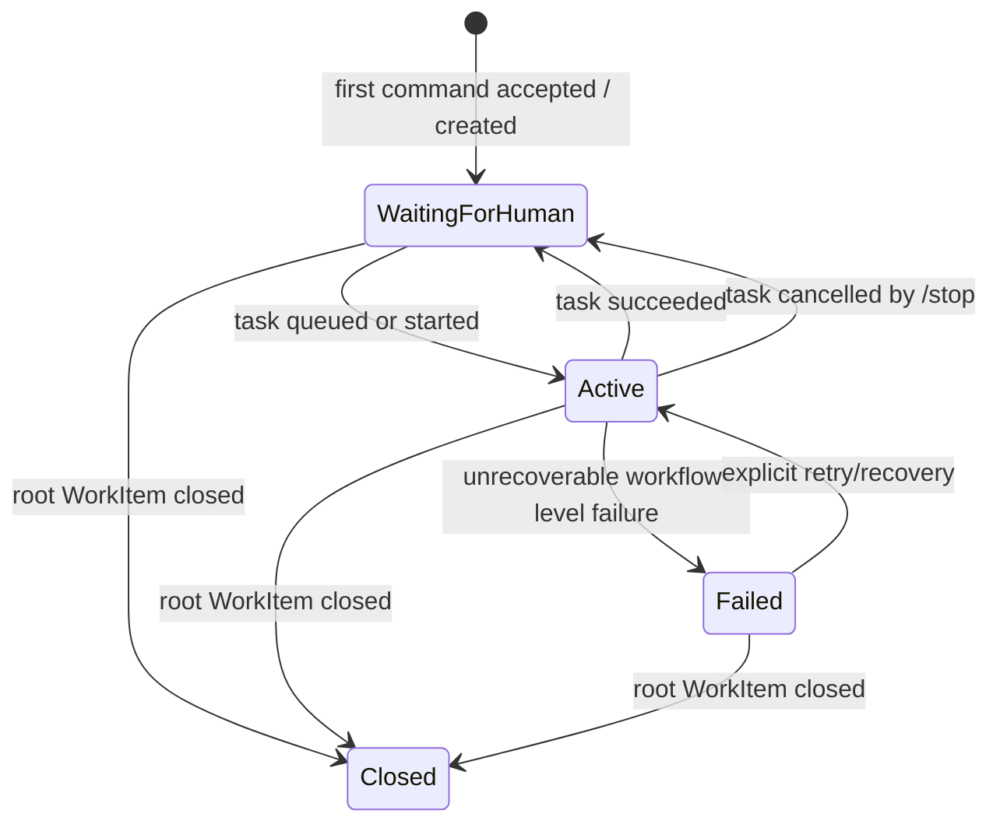
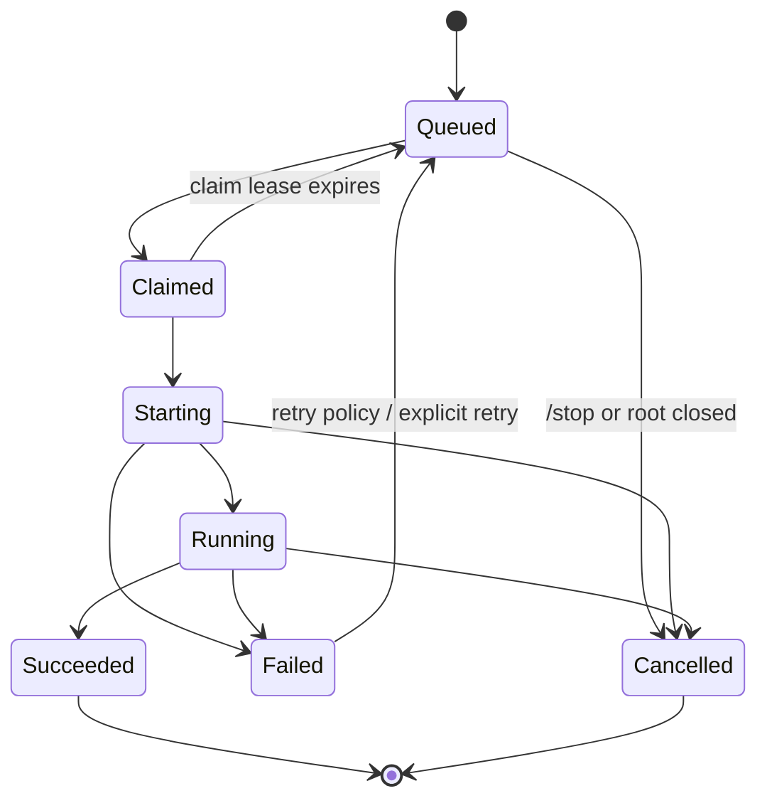
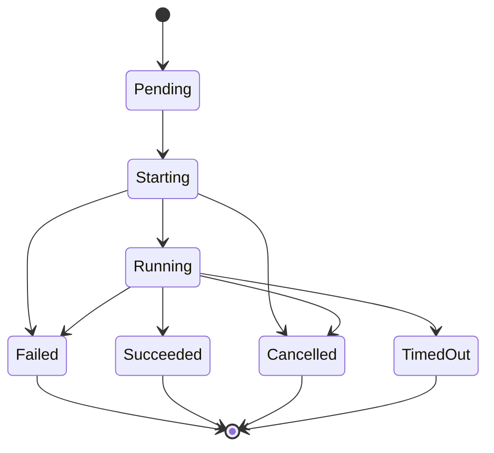
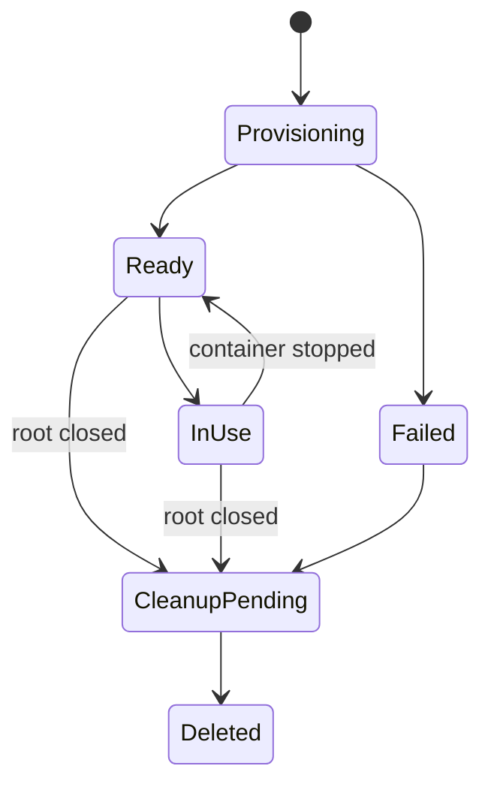

# State Machines

These are proposed V1 states. State transitions are owned by the Orchestrator and should be validated explicitly. Agents report execution facts; they do not directly mutate Workflow/Task state.

## 1. Workflow

A Workflow is a long-lived orchestration record for one root WorkItem. It can contain several sequential Tasks over time. Completing one Task normally returns the Workflow to `waiting_for_human`; it does not permanently complete the Workflow.

- `WaitingForHuman`: no Task is currently executing; next action requires a command or external trigger.
- `Active`: a Task is queued/claimed/starting/running (the global queue may also contain work for other WorkItems).
- `Failed`: an unrecoverable workflow-level failure requiring explicit recovery.
- `Closed`: root Issue/PR is closed; no new Tasks are accepted and cleanup is enforced.

`Completed` and `Cancelled` may be retained as administrative terminal states if a future explicit workflow-completion operation is added. V1 does not need a `/complete` command; root closure is represented by `Closed`.

## 2. Task

- `Queued`: durable work waiting for the single V1 execution slot.
- `Claimed`: worker holds a lease.
- `Starting`: profile/session/workspace/container are being prepared.
- `Running`: agent is executing.
- `Succeeded`: result and required artifacts are persisted; required external actions (e.g. push/comment/review) completed according to task policy.
- `Failed`: execution failed; retry may create another Run for the same Task if its session/workspace remain usable.
- `Cancelled`: execution was intentionally stopped.

If a retry cannot safely reuse the Task's session/workspace, create a replacement Task rather than silently attaching a different Task's context.

## 3. Run

Each Run is one attempt. A retry creates a new Run with a higher attempt number.

Run is terminal after `Succeeded`, `Failed`, `Cancelled`, or `TimedOut`. A Run references the AgentSession for its Task and the ContainerInstance used for that attempt.

## 4. AgentSession

A new Pi session is created for every Task. A session is never shared with another Task/profile. Its files remain on persistent host storage until root WorkItem cleanup.

```mermaid
stateDiagram-v2
    [*] --> Created
    Created --> Available
    Available --> InUse: Run starts
    InUse --> Available: Run ends; session retained
    InUse --> Error
    Error --> Available: runtime/session recovered
    Available --> CleanupPending: root closed
    InUse --> CleanupPending: root closed/cancel
    Error --> CleanupPending
    CleanupPending --> FilesDeleted
```

`Available` means no Run is currently using the session; it does not mean the session can be assigned to a different Task. The DB row remains after the backing file is deleted. Track file state separately (`available`, `cleanup_pending`, `deleted`, `missing`).

## 5. ContainerInstance

Track desired and observed states separately.

Desired state:
- `running`
- `stopped`
- `removed`

Observed state:
- `unknown`
- `created`
- `running`
- `stopping`
- `stopped`
- `failed`
- `removed`

On Task completion or `/stop`, desired state becomes `stopped`. On root closure, desired state becomes `removed`. Reconciliation updates observed state and applies desired state.

## 6. Workspace

Workspace belongs to one Task. It persists independently of the container. A Reviewer Task gets a fresh workspace at the exact PR Head SHA; it must not reuse coder's writable workspace.

## 7. GitHubEvent and AgentCommand

GitHubEvent:
- `received`
- `processing`
- `processed`
- `ignored`
- `failed`

AgentCommand:
- `received`
- `rejected`
- `authorized`
- `queued`
- `processed`
- `failed`

`status`, `stop`, and `help` are commands but do not create Tasks. Unauthorized/invalid commands are retained with a rejection reason. Duplicate command delivery is ignored using GitHub comment ID.

## 8. OrchestrationJob and OutboxAction

Job:
- `pending`
- `processing`
- `completed`
- `failed`
- `cancelled`

An expired processing lease returns a retryable job to `pending`.

OutboxAction:
- `pending`
- `processing`
- `completed`
- `failed`
- `cancelled`

External writes use retries and idempotency keys. A GitHub write is not marked completed until the API call succeeds or a defined terminal policy is applied.

## 9. Heartbeat, stale Run, and recovery

Track separately:
- Runtime heartbeat: runtime/container/session is reachable.
- Progress: meaningful task activity.
- Process/tool activity where available.

A 60-minute heartbeat timeout is an initial configurable threshold. A stale signal initiates reconciliation; it does not immediately destroy the container. Check Komodo/container state, runtime session, active process/command, and Run state before stopping/retrying/failing. Silence in progress messages alone is not proof of a hung agent.

## 10. Root WorkItem closure

Closure triggers cleanup for that root only:
1. Mark Workflow `closed`; reject/cancel new or queued work.
2. Cancel active Tasks/Runs.
3. Stop and remove containers/deployments.
4. Remove task workspace volumes.
5. Delete Pi session files.
6. Mark cleanup/deletion flags in PostgreSQL.
7. Retain database records and history.

A related Issue and PR are separate roots. Closing one does not automatically clean the other.
