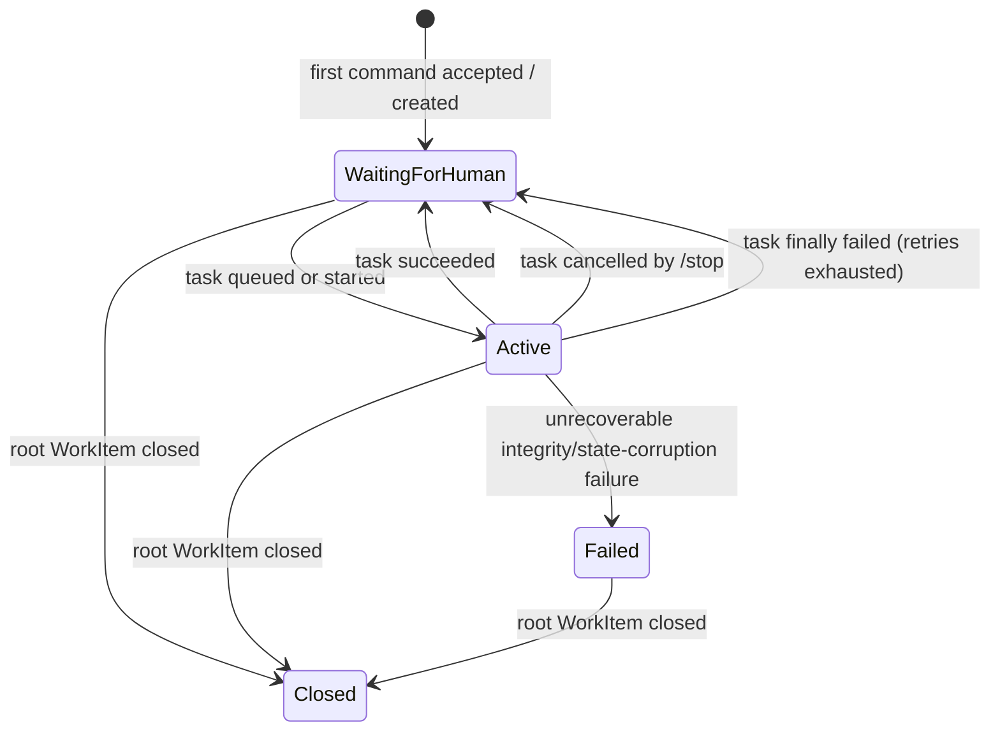
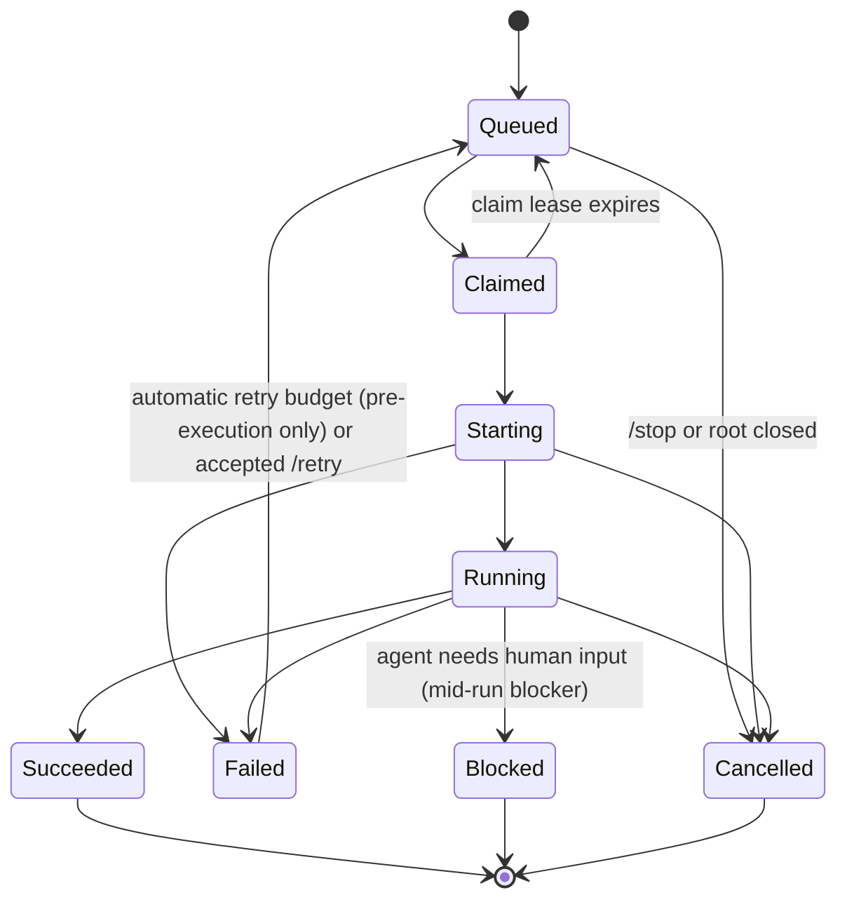
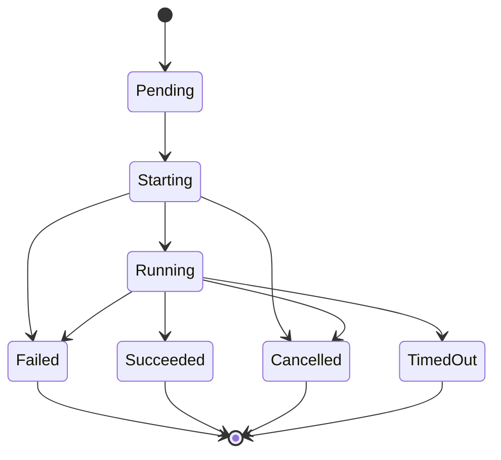
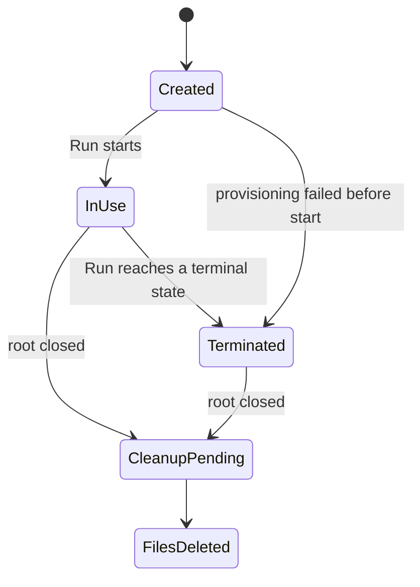
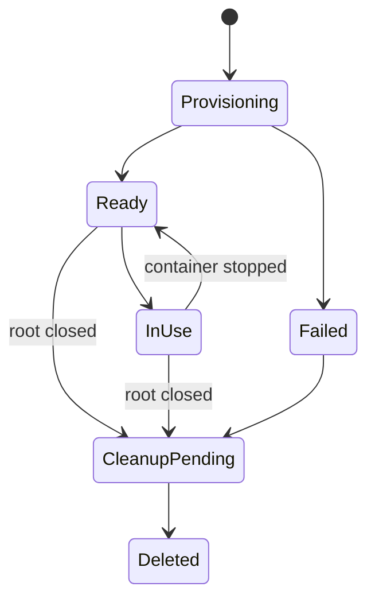

# State Machines

These are proposed V1 states. State transitions are owned by the Orchestrator and should be validated explicitly. Agents report execution facts; they do not directly mutate Workflow/Task state.

## 1. Workflow

A Workflow is a long-lived orchestration record for one root WorkItem. It can contain several sequential Tasks over time. Completing one Task normally returns the Workflow to `waiting_for_human`; it does not permanently complete the Workflow.

- `WaitingForHuman`: no Task is currently executing; next action requires a command or external trigger.
- `Active`: a Task is queued/claimed/starting/running (the global queue may also contain work for other WorkItems).
- `Failed`: an unrecoverable integrity/state-corruption failure requiring operator intervention (contradictory Workflow data, unclear root WorkItem, broken Task-sequence invariants). Ordinary execution failures, missing images, unavailable runtimes, GitHub errors, and exhausted retries do NOT fail the Workflow. In V1 `Failed` is terminal: recovery requires manual operator intervention at the data level; only `/status`, `/help`, and root closure remain possible (decision 71).
- `Closed`: root Issue/PR is closed; no new Tasks are accepted and cleanup is enforced.

`Completed` and `Cancelled` may be retained as administrative terminal states if a future explicit workflow-completion operation is added. V1 does not need a `/complete` command; root closure is represented by `Closed`.

## 2. Task

- `Queued`: durable work waiting for global execution capacity (`max_concurrent_runs`).
- `Claimed`: worker holds a lease.
- `Starting`: profile/session/workspace/container are being prepared. `startup_timeout` (default 10 minutes) fails the Run with `startup_timeout` if preparation never completes.
- `Running`: agent is executing.
- `Succeeded`: result and required artifacts are persisted; required external actions (e.g. push/comment/review) completed according to task policy.
- `Failed`: execution failed. Automatic retry is allowed only for transient infrastructure errors before the Run starts executing; after execution began, recovery is manual (`/retry`), which creates a new Run with a new Pi session.
- `Cancelled`: execution was intentionally stopped.
- `Blocked`: terminal state for a Task whose Run finished with `outcome = needs_human_input` — the agent published its question and checkpointed its work to the agent branch; resolution requires a new Task/Run after the human answers (decision 72).

Retry semantics (decision 70): automatic retry applies only to transient infrastructure errors before the Run starts executing and transitions the Task `Failed → Queued` only while retry budget remains. After execution began, `/retry` is the manual path: the Orchestrator moves the Task `Failed → Queued` and creates the new OrchestrationJob in one transaction; the Task then follows the normal claim flow with `attempt_number + 1` and a new AgentSession. No Run ever starts while the Task is still `Failed`; a rejected `/retry` (preconditions, admission, occupancy, or `agent_profile_not_ready` on the pinned profile version) leaves the Task `Failed`.

If a retry cannot safely reuse the Task's session/workspace, create a replacement Task rather than silently attaching a different Task's context.

## 3. Run

Each Run is one attempt. A retry creates a new Run with a higher attempt number.

Run is terminal after `Succeeded`, `Failed`, `Cancelled`, or `TimedOut`. A Run references its own AgentSession (one new session per attempt) and the ContainerInstance used for that attempt. `TimedOut` comes from the wall-clock `max_run_duration` limit (default 4 hours); idle/heartbeat timeouts only trigger reconciliation and never produce `TimedOut`. A `TimedOut` Run does not trigger an automatic retry (it happens after execution began); the recovery path is `/retry`.

## 4. AgentSession

A new Pi session is created for every Run attempt (a retry creates another session for the same Task). A session is never shared with another Task/profile/Run. Its files remain on persistent host storage until root WorkItem cleanup. The DB record is created by the Orchestrator when the Run is prepared (`provisioning`); the Runtime API provisions the backing files and reports runtime metadata.

`Available` as a service state does not exist: an AgentSession is one-shot and 1:1 with its Run (`AgentSession.run_id` unique) — it is never reassigned, pooled, or reused, and a terminated Session never returns to service (decision 57). Recovery after a Runtime API restart may reopen the backing files of the same Run only. The DB row remains after the backing files are deleted; file state is tracked separately (`available`, `cleanup_pending`, `deleted`, `missing`).

## 5. ContainerInstance

Track desired and observed states separately.

Desired state:
- `running`
- `stopped`
- `removed`

Observed state:
- `unknown`
- `created`
- `running`
- `stopping`
- `stopped`
- `failed`
- `removed`

On Task completion or `/stop`, desired state becomes `stopped`. On root closure, desired state becomes `removed`. Reconciliation updates observed state and applies desired state.

## 6. Workspace

Workspace belongs to one Task. It persists independently of the container. A Reviewer Task gets a fresh workspace at the exact PR Head SHA; it must not reuse coder's writable workspace.

## 7. GitHubEvent and AgentCommand

GitHubEvent:
- `received`
- `processing`
- `processed`
- `ignored`
- `failed`

AgentCommand:
- `received`
- `rejected`
- `authorized`
- `queued`
- `processed`
- `failed`

`status`, `stop`, and `help` are commands but do not create Tasks. Unauthorized/invalid commands are retained with a rejection reason. Duplicate command delivery is ignored using GitHub comment ID. These statuses describe command handling only: queue waiting is expressed by `Task`/`OrchestrationJob` states and human waiting by `Workflow.status = waiting_for_human` (no separate `waiting` status).

## 8. OrchestrationJob and OutboxAction

Job:
- `pending`
- `processing`
- `completed`
- `failed`
- `cancelled`

An expired processing lease returns a retryable job to `pending`. Queue order is FIFO by `available_at` then `priority`; `/stop` cancellation runs outside the queue as an immediate control path.

OutboxAction:
- `pending`
- `processing`
- `completed`
- `failed`
- `cancelled`

External writes use retries and idempotency keys. A GitHub write is not marked completed until the API call succeeds or a defined terminal policy is applied.

## 9. Heartbeat, stale Run, and recovery

Track separately:
- Runtime heartbeat: Runtime Bridge liveness, sent on a fixed cadence (default 30 seconds). Liveness alone is not progress.
- Progress: meaningful task activity (events, tool activity, session updates, completion).
- Process/tool/container activity observed by the Execution Host Monitor (session-file changes, process tree, CPU/IO — decision 62). The Bridge reports heartbeat, RPC/request activity, and run/tool events; the Host Monitor reports filesystem/process/container activity; the Runtime API stores both signal streams for the Orchestrator.

Three independent limits apply:
- `idle_timeout` (default 60 minutes): the container is alive (heartbeat continues) but there is no observable activity at all — no events, no progress, no completion, no session update. It initiates reconciliation; it does not immediately destroy the container and does not produce `TimedOut`. Check Komodo/container state, runtime session, active process/command, and Run state before stopping/retrying/failing. A confirmed hang ends the Run as `Failed` with `error_code = idle_timeout`; `max_run_duration` still produces `TimedOut` independently (decision 68).
- `max_run_duration` (default 4 hours): wall-clock execution limit; exceeding it stops the container and ends the Run as `TimedOut`.
- `startup_timeout` (default 10 minutes): preparation never completed; the Run fails with `startup_timeout`.

A `permission_blocked` event is not progress and resets no timer. Heartbeat, thinking deltas, and queue updates are also never progress. Silence in progress messages alone is not proof of a hung agent.

## 10. Root WorkItem closure

Closure triggers cleanup for that root only:
1. Mark Workflow `closed`; reject/cancel new or queued work.
2. Cancel active Tasks/Runs.
3. Stop and remove containers/deployments.
4. Delete the Workflow storage tree — task workspace directories and per-Run `pi-session/` and `logs/` under `/var/lib/pi-agent/workflows/{workflow_id}/`.
5. Mark cleanup/deletion flags in PostgreSQL.
6. Retain database records and history.

A related Issue and PR are separate roots. Closing one does not automatically clean the other.
